# Gestion table tournante Libre — le guide d’usage

Ce guide suit une soirée du début à la fin : ouvrir un événement, y mettre les
participants et les tables, laisser le logiciel chercher des placements, en
retenir un, l’ajuster, puis imprimer. Il s’adresse à la personne qui prépare la
soirée ; il ne suppose rien de la façon dont le logiciel est écrit.

Les écrans montrés ici se reproduisent. Le parcours crée un événement nommé
« Soirée d’essai », y importe le fichier `exemples/participants_cas_limites.csv`
livré avec le logiciel, donne une étiquette à une personne, pose deux tables et
leurs objectifs, importe `exemples/objectifs_cas_limites.csv`, désigne un
animateur, règle l’ordre des priorités et génère avec la graine 4242 et un
compte d’arrêt de 300, les autres réglages de génération gardant leur valeur
par défaut ; les étapes où la taille compte chargent la « Grande
démonstration » depuis le premier écran. Suivez les mêmes gestes, avec les
mêmes réglages, et vous verrez les mêmes écrans.

Les étapes sont **un ordre de lecture, pas un assistant** : le logiciel
n’enchaîne rien et ne vous oblige jamais à revenir au début. Une faute de
saisie découverte au moment d’imprimer se corrige à l’endroit où elle se trouve.

Pour installer et lancer le logiciel sous Windows, et savoir où vont vos
fichiers, lisez `GUIDE-WINDOWS.md`.

## Avant de commencer : lecture, écriture, et trois garanties

**Tout événement s’ouvre en lecture.** Rien ne s’y modifie tant que vous n’avez
pas cliqué sur « Modifier », toujours à la même place, en haut de l’écran. La
bande de couleur sous le bandeau, le libellé à côté de « Modifier » et le
bandeau disent dans quel mode vous êtes. Après un
moment d’inactivité, le logiciel revient seul en lecture, entre deux gestes et
jamais au milieu de l’un d’eux.

**Un plan bloqué** refuse toute modification, import compris, jusqu’à ce que
vous le débloquiez. L’état du plan — « Brouillon », « Proposé », « Retenu »,
« Bloqué » — se lit et se change en haut de l’événement.

Tout geste qui modifie l’événement suit trois règles :

1. une fois achevé, il est **à la fois** dans l’historique et sur le disque ;
   il n’y a jamais rien à enregistrer ;
2. il se reprend : « Défaire » et « Refaire » remontent et redescendent
   l’historique, qui ne perd jamais rien ;
3. s’il est refusé, le refus dit pourquoi et, quand un geste le lève, lequel —
   à l’endroit même où vous avez agi : sur la place, sur la ligne de l’aperçu
   d’import, sur le champ. Seul un geste qui détruit de la saisie ouvre une
   fenêtre de confirmation.

Lire le diagnostic et comparer les propositions ne modifient rien : ces écrans
restent utilisables en lecture.

## Étape 1 — Ouvrir ou créer l’événement

Le premier écran est la liste des événements. Quand elle est vide, elle n’est
jamais une page blanche : elle offre de créer un événement et de charger l’une
des démonstrations livrées. Elle affiche aussi le dossier de travail, avec la
commande qui l’ouvre dans l’explorateur.

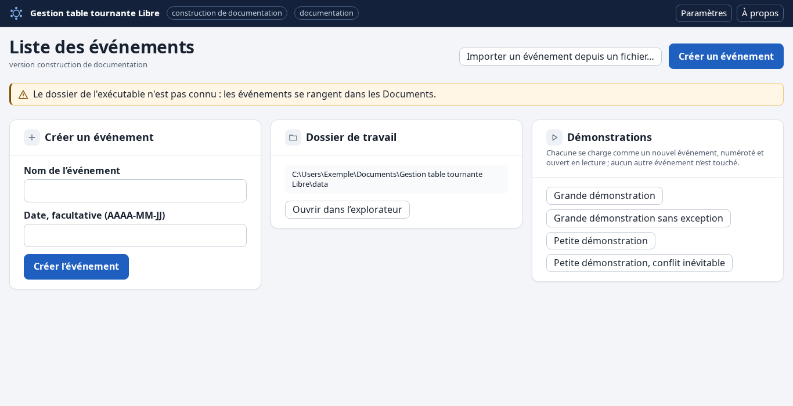

*Regardez la partie « Démonstrations » : chacune se charge comme un nouvel
événement, ouvert en lecture, sans toucher aux autres. Sous « Créer un
événement », seul le nom est exigé ; la date est facultative, choisie dans le
calendrier du champ ; une date commencée doit être complète et exister au
calendrier.*

Ouvrir un événement existant ne réécrit jamais son fichier. Créer un événement,
ou charger une démonstration, en écrit un nouveau. Le nom d’un événement compte
au plus 68 caractères : au-delà, la création, la copie et le renommage le
refusent en disant la longueur saisie, sans rien couper.

Chaque événement a son propre dossier dans le dossier de travail, à son nom :
le chemin qu’affiche sa ligne est celui de son fichier d’état, dans ce dossier,
qui garde aussi son historique et reçoit ses badges et sa liste en CSV. À côté
des dossiers d’événement, le dossier de travail porte la corbeille et les
réglages du poste. Créer, copier, importer un événement ou charger une
démonstration crée son dossier. Renommer l’événement renomme aussi son
dossier : tout ce qu’il contient suit, et les badges et la liste déjà produits
prennent le nouveau nom, leur date gardée. Supprimer range tout ce que porte le
dossier dans un dossier daté de la corbeille, d’où rien ne s’efface, puis
retire le dossier. Quand le dossier ne peut pas être retiré, après l’un ou
l’autre — un fichier encore ouvert dans un autre programme, par exemple —, il
reste sur le disque avec ce qu’il contient, et un avis le nomme au-dessus de la
liste. Des fichiers d’événement posés directement dans le dossier de travail,
hors d’un dossier — ceux d’une version antérieure —, ne s’affichent pas et
restent tels quels ; une version antérieure, elle, ne voit pas les événements
rangés en dossiers.

## Étape 1b — Passer en écriture

L’événement s’ouvre en lecture. Tentez un geste qui modifie, par exemple
« Ajouter une table ronde » dans la section « Tables et tours » : le refus
s’affiche à côté du bouton, et propose « Modifier ».

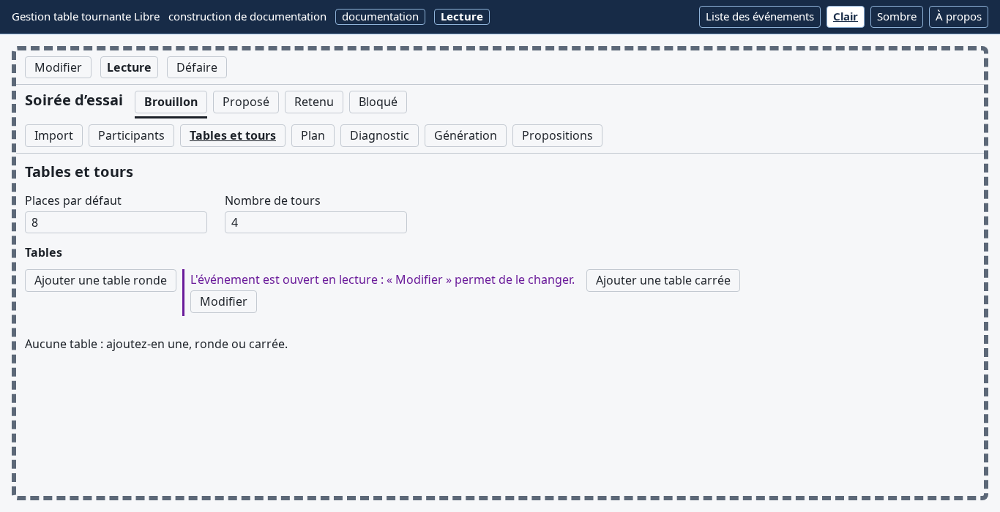

*Le refus apparaît là où vous avez cliqué, sans fenêtre. Le mot « Lecture »
figure dans le bandeau, dans la bande de mode et à côté de « Modifier ».*

Cliquez sur « Modifier » : la bande et le libellé passent en écriture, et le
même geste réussit. « Revenir en lecture » fait l’inverse.

## Étape 2 — Importer la liste des participants

Cette étape est facultative : la liste peut aussi se saisir à la main
(étape 3). Dans la section « Import », choisissez un fichier CSV ou déposez-le
sur la fenêtre. **Rien ne s’importe avant l’aperçu.**

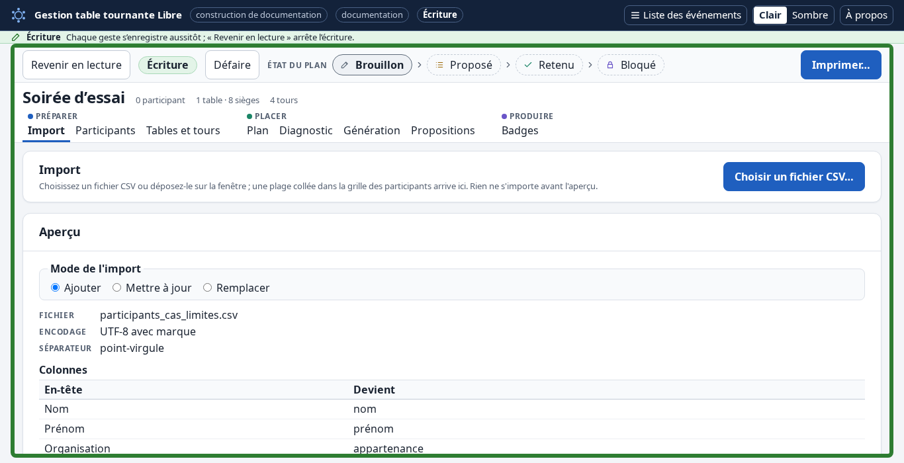

*L’aperçu nomme l’encodage et le séparateur que le logiciel a reconnus, dit ce
que devient chaque colonne — « Organisation » reste l’organisation, « Rôle »
devient le titre pressenti — et signale une colonne non reconnue, ignorée.
Vérifiez ces trois lignes avant d’importer.*

Le mode de l’import se choisit au même endroit : « Ajouter » ajoute des
personnes, « Mettre à jour » met à jour celles que le fichier reconnaît sans
effacer les champs qu’il ne porte pas, « Remplacer » remplace la liste et
annonce d’abord ce qu’il détruit.

Deux lignes au même nom, prénom et organisation — ou une ligne qui reprend une
personne déjà dans la liste — se signalent en doublons : chacun nomme la
personne et ses lignes, « Roger Galet — lignes 15 et 16 », numérotées comme la
colonne « Ligne » de l’aperçu et comme le tableur, l’en-tête en ligne 1. Le
logiciel ne fusionne jamais deux personnes : s’il s’agit bien de deux convives,
« Rendre les noms uniques » garde le nom de la première et ajoute aux suivantes
un numéro, « Galet 01 », « Galet 02 », en sautant un numéro déjà pris. Votre
fichier n’est pas modifié : l’aperçu se recalcule sur ces noms, et le rapport
compte les noms rendus uniques. En mise à jour, une ligne qui met à jour une
personne de la liste garde son nom.

Un fichier enregistré par un tableur sous Windows n’est souvent pas en UTF-8.
Le logiciel le reconnaît et le dit :

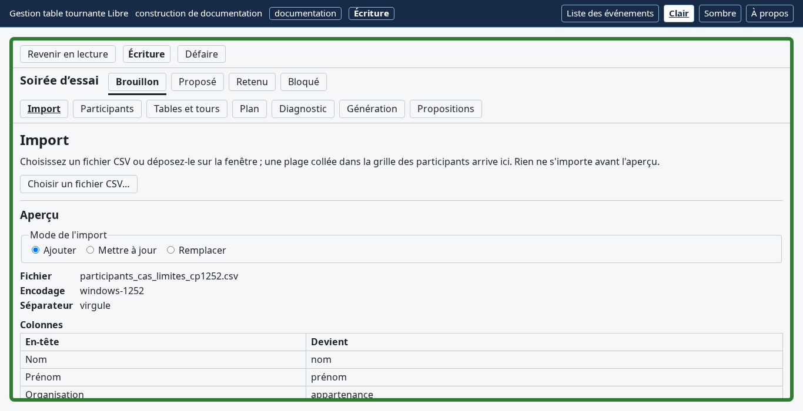

*Ici l’encodage lu est « windows-1252 » et le séparateur la virgule. Vérifiez
un nom accentué : « Givrecœur » et « Héloïse » doivent s’afficher tels quels. Un
prénom écrit « Héloïse » au lieu de « Héloïse » trahit un encodage mal lu, et
rien d’autre ne vous en avertirait.*

Après l’import, le rapport compte ce qui est entré :

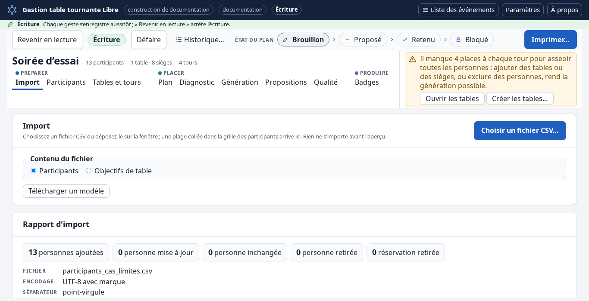

*Le rapport compte les personnes ajoutées, mises à jour, inchangées ou
retirées, regroupe les orthographes d’une même organisation qu’il a fondues, et
liste les lignes refusées avec leur motif. « Enregistrer les lignes refusées »
les écrit dans un fichier, pour les corriger dans un tableur et les réimporter.
L’import entier compte pour un seul geste : « Défaire » le reprend d’un coup.*

« Télécharger un modèle » donne un fichier de participants prêt à remplir :
quatre personnes inventées dont les cellules remplissent chaque colonne
reconnue (annexe B). Sa colonne « présence » suit le nombre de tours de
l’événement. Une présence s’écrit en tours et en plages — « 1-3 », « 2, 3 »,
« tours 1 et 2 » — ; « tous » vaut tous les tours, et une cellule vide aussi,
pour une personne que l’import crée. Le modèle s’importe tel quel, sans
qu’aucune ligne soit refusée.

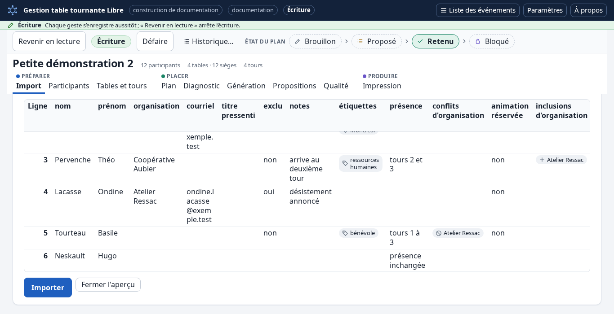

*L’événement a quatre tours : la cellule « 2, 3 » se lit « tours 2 et 3 », la
plage « 1-3 », « tours 1 à 3 ». La liste étant peuplée, l’import met à jour.
Les quatre personnes du modèle n’y sont pas : il les crée, et leur cellule
vide ne dit rien, elle vaut tous les tours. La dernière ligne, ajoutée au
modèle, désigne par son nom et son prénom une personne déjà inscrite : sa
cellule vide garde sa présence, et l’aperçu l’écrit « présence inchangée ».
Un tour que la soirée n’a pas, ou une cellule qu’un tableur a changée en
date, refuse sa ligne avec son motif ; mettez la colonne en texte dans le
tableur.*

Une colonne « Conflit organisation » nomme, pour chaque personne, les
organisations que la sienne entière doit éviter à table (étape 3) ; plusieurs
noms se séparent par « ; », « | » ou un retour à la ligne dans la cellule, et
une virgule reste dans le nom. Le fichier se lit en entier avant que rien ne
s’importe : une organisation qu’une autre ligne du même fichier apporte se
nomme sans difficulté, et un nom écrit autrement que l’événement — casse,
accents, blancs — prend l’orthographe que l’événement emploie déjà. Mais un nom
qu’aucune personne ne porte, ou la propre organisation de la personne, **refuse
le fichier entier** : l’aperçu dit, par exemple, « L’organisation « Société
Gamma » n’existe pas (ligne 4, colonne des conflits). Rien n’est importé. »,
puis invite à corriger la ligne et à importer le fichier de nouveau. Un nom
d’organisation qui porte lui-même « ; » ou « | » se lit entier, pourvu qu’il
soit écrit comme l’organisation que porte une personne. En mise à jour, une
organisation que seule apporterait une ligne refusée — elle désigne plusieurs
personnes, ou une personne qu’une ligne plus haut désigne déjà — n’existe
pas pour les conflits.

Un import est refusé sur un plan bloqué ; le message nomme la commande qui
débloque. Un aperçu ouvert avant un changement du nombre de tours ne
s’importe pas : rechoisissez le fichier pour refaire l’aperçu.

## Étape 3 — Compléter la liste à la main

Dans la section « Participants », la grille se modifie directement. Seul le nom
est exigé ; le logiciel n’invente aucune valeur manquante. La ligne « Ajouter
une personne » ajoute quelqu’un ; une plage de cellules copiée d’un tableur et
collée dans la grille passe par l’aperçu d’import.

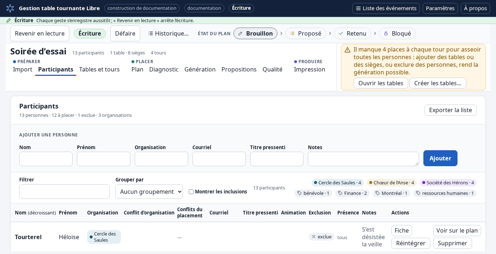

*Le compte des participants égale celui de l’import. La personne marquée
« exclue » reste dans la liste mais n’est plus placée, et ne compte plus dans
aucune statistique : « Réintégrer » la remet. Cliquez sur un en-tête de colonne
pour trier, tapez dans « Filtrer » pour réduire la liste.*

« Exporter la liste » écrit la grille dans un fichier CSV. L’export écrit
chaque valeur telle qu’elle a été saisie, sans rien y ajouter : un tableur qui
l’ouvre peut prendre pour une formule une cellule qui commence par « = »,
« + », « - » ou « @ ». Si une valeur commence ainsi, ouvrez le fichier par la
commande d’import de texte du tableur, colonnes en texte.

La fiche d’une personne, ouverte par « Fiche » dans la grille, montre en tête
son nom, son prénom, son organisation, son courriel, son titre pressenti et ses
notes, « — » pour une valeur absente. « Modifier » les remplace par un
formulaire prérempli, le curseur dans le nom ; « Enregistrer », ou Entrée,
écrit les seuls champs changés en un seul geste, que « Défaire » ou Ctrl+Z
reprend, et ne fait rien quand rien n’a changé ; « Annuler », ou Échap,
referme sans rien écrire. Tapée « FINANCE » quand une autre personne porte
« Finance », l’organisation s’enregistre sous « Finance », et la fiche le dit.
Un nom vidé est refusé sous le champ, le formulaire gardé. En lecture et sur
un plan bloqué, « Modifier » refuse à côté du bouton, en nommant le geste qui
lève le refus.

Chaque personne peut porter des **étiquettes** — « finance », « bénévole »,
« Montréal » —, que les objectifs des tables attendent (étape 4). Une colonne
« Étiquettes » du fichier les importe ; la fiche d’une personne, ouverte par
« Fiche » dans la grille, les montre et les modifie. Elles ne sont exigées
nulle part.

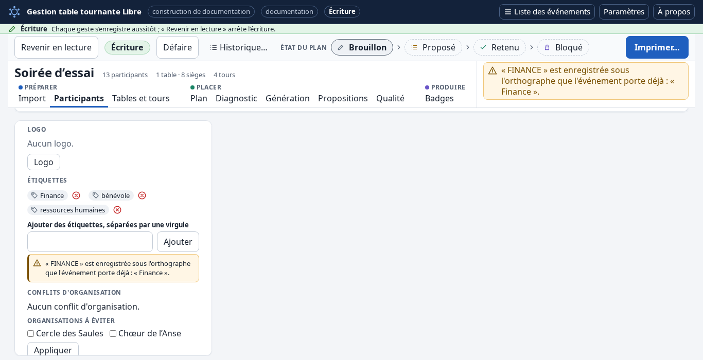

*Chaque étiquette est une pastille grise ; en écriture, une petite croix
rouge cerclée la suit, qui la retire. Tapez une ou plusieurs étiquettes séparées par une virgule, puis « Ajouter »
ou Entrée. Ici, « FINANCE » s’enregistre sous « Finance », l’orthographe que
l’événement porte déjà, et le logiciel le dit sous le champ : une même
étiquette ne s’écrit jamais de deux façons. La légende, au-dessus de la
grille et hors de cette image, compte les personnes qui portent chaque
étiquette.*

Chaque personne a aussi une **présence** : les tours où elle est là. Elle vaut
« tous » tant que vous ne la changez pas. Un retard, un départ avant la fin,
une arrivée en cours de soirée se disent là, avant comme pendant la soirée.
Dans la grille, la colonne « Présence » écrit « tous », ou les tours de
présence — « tour 2 », « tours 1 et 2 », « tours 1 à 3 » — ; Entrée ou F2 sur
sa cellule l’ouvre en cases, une par tour.

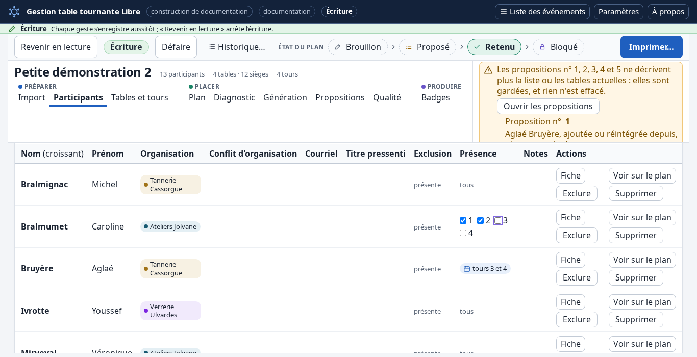

*Les cases de la deuxième ligne sont ouvertes au clavier : ← et → passent
d’une case à l’autre, Début et Fin à la première et à la dernière, et
l’espace coche ou décoche sans rien écrire. Entrée, Tab ou la sortie des
cases enregistrent la présence en un seul geste, que « Défaire » reprend ;
Échap rend la présence enregistrée. Une saisie revenue à l’enregistrée
n’écrit rien. La troisième ligne est déjà « tours 3 et 4 ».*

La fiche porte les mêmes cases, sous « Présence », avec « Tous les tours »,
qui coche chaque case sans rien écrire, et « Appliquer », qui enregistre la
présence en un geste.

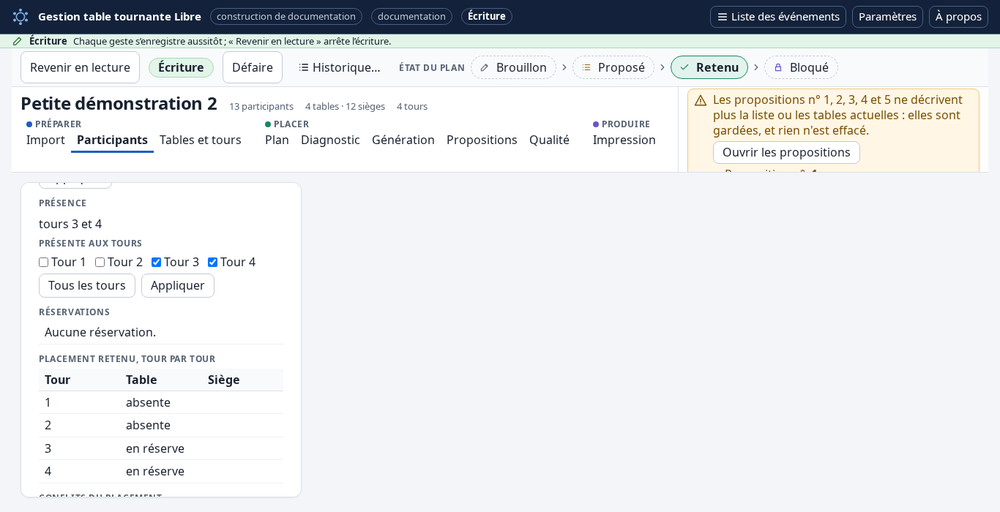

*Une personne ajoutée pendant la soirée, présente aux tours 3 et 4.
L’itinéraire du placement retenu la dit absente aux deux premiers tours, puis
en réserve, en attente d’une chaise : changer une présence ajuste le placement
retenu dans le même geste (étape 11). Une présence sans aucun tour est
refusée contre les cases ; pour écarter quelqu’un de toute la soirée,
excluez-le. La ligne des comptes, au-dessus de la grille, compte les
présences partielles, et la grille se trie et se groupe par présence.*

Une personne absente à un tour n’y a ni chaise ni place en réserve, et ne
compte pas dans les places de ce tour : quand une personne part après le
tour 2 et qu’une autre arrive au tour 3, la salle reste juste pleine. Une
réservation ne vaut qu’aux tours de présence de sa personne : ailleurs, elle
est suspendue, sa place rendue aux autres, et le logiciel le dit. Étendre une
présence à un tour où sa réservation ferait déborder une table, ou prendrait
un siège réservé à une autre, est refusé.

Une personne peut aussi nommer des **organisations en conflit** : deux
entreprises concurrentes, deux familles brouillées. Si une personne de
l’organisation A nomme X, aucun membre de A ne devrait partager une table avec
un membre de X, à aucun tour, et réciproquement ; une personne sans
organisation qui nomme X évite X seule. La colonne « Conflit d’organisation »,
juste après l’organisation, écrit chaque organisation nommée. Entrée ou F2 sur
sa cellule l’ouvre en cases, une par organisation de l’événement, la sienne
exceptée ; les touches sont celles des cases de la présence, et Entrée
enregistre ajouts et retraits en un seul geste, que « Défaire » reprend d’un
coup. La fiche porte les mêmes cases, sous « Conflits
d’organisation », avec « Appliquer ». Ce n’est pas une interdiction : la
recherche les évite autant qu’elle peut (étape 9), et un placement qui en garde
le dit.

Une fois des propositions générées (étape 9), la colonne « Conflits du
placement », juste après celle des conflits d’organisation, dit pour chaque
personne ce qui cloche dans le placement que le plan montre — la proposition que
vous regardez, sinon le placement retenu —, tour par tour, en nommant qui elle
revoit et à quelle table elle revient : « tour 2 : même organisation »,
« tour 4 : conflit d’organisation ; se revoient avec Iris Ombrelle et
Théo Pervenche ; revient à la table 5 ». Un tiret dit qu’elle n’a aucun conflit,
ou qu’aucun placement n’est montré ; « non compté », que le placement montré a
dérivé depuis (une personne exclue, une table changée) et que ses conflits ne se
comptent plus. Ce sont les conflits mêmes que comptent les pastilles du plan, de
toutes les règles ; la colonne se lit seulement, ne se trie pas, et l’export
n’en écrit rien. La fiche de la personne les détaille sous « Conflits du
placement », juste avant « Rencontres » : une ligne par conflit, « Tour 2,
table 5 : avec Iris Ombrelle — même organisation ».

Une personne peut enfin porter un **logo** — celui de son organisation, par
exemple —, que son badge imprime (étape 12). Il se pose dans sa fiche, sous la
rubrique « Logo », entre ses valeurs et ses étiquettes ; la rubrique montre la
vignette du logo, ou « Aucun logo. ». Le bouton « Logo » ouvre le choix d’une
image, puis pose le logo, ou remplace celui que la personne portait. Une image
PNG, JPEG, GIF, WebP, AVIF, BMP, ICO ou SVG convient. Une photo HEIC, une image
TIFF ou un fichier qui ne s’ouvre pas comme une image est refusé : exportez-le
d’abord en JPEG ou en PNG. Un fichier de plus de 25 Mo est refusé sans être lu,
une image de plus de 50 millions de pixels sans être ouverte. Le logiciel range
le logo dans le dossier de l’événement, en PNG : redressé selon l’orientation de
la photo, sa transparence gardée, ramené à 1 200 pixels de plus grand côté,
jamais agrandi ; un SVG, dessin sans résolution propre, se dessine à 1 200
pixels de plus grand côté. Un clic sur la vignette montre le logo à la largeur
de la fiche, dans la fiche même ; « Fermer », ou Échap, rend la vignette. Cette
vue se lit aussi en lecture.

« Retirer le logo » n’est offert qu’en écriture, hors d’un plan bloqué ; en
lecture et sur un plan bloqué, « Logo » refuse à côté du bouton avant d’ouvrir
quoi que ce soit, en nommant le geste qui lève le refus. Poser, remplacer ou
retirer un logo est un geste : « Défaire » rend le logo d’avant. Aucune image
ne s’efface : celle d’un logo retiré ou remplacé reste dans le sous-dossier
`logo` du dossier de l’événement, et n’en part qu’avec l’événement, pour la
corbeille.

« Logo introuvable » dit que la fiche désigne une image que le dossier de
l’événement n’a pas, ou qui ne se lit pas. La cause ordinaire : un événement
venu d’un seul fichier, par « Importer un événement depuis un fichier… », qui
n’emporte pas le sous-dossier `logo`. « Copier », « Importer ces événements »
depuis l’autre emplacement et l’écriture ailleurs qu’offre une écriture
échouée — « Écrire dans les Documents » ou « Choisir un dossier… » — emportent
les logos ; un logo qui ne se recopie pas n’empêche jamais l’opération, et un
avertissement compte ceux restés en arrière. Choisir de nouveau l’image par
« Logo » la remet en place, et la vignette paraît aussitôt ; recopiée à la main
dans le sous-dossier `logo`, elle paraît quand on rouvre la fiche.

Le fichier des participants ne porte pas de logo : l’export n’en écrit pas, et
un import « Mettre à jour » garde ceux des personnes. « Remplacer » retire
chaque personne avec son logo ; après l’import, un avertissement compte les
logos retirés, et « Défaire » les rend.

## Étape 4 — Préparer les tables

Dans la section « Tables et tours », fixez d’abord les **places par défaut**,
puis ajoutez les tables, rondes ou carrées. Chaque table suit le défaut, ou
porte son propre nombre de places : on dit alors qu’elle est surchargée.

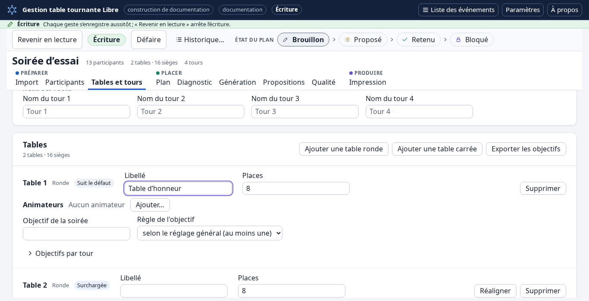

*Les deux tables ont le même nombre de places, mais l’une « Suit le défaut » et
l’autre est « Surchargée » : seule la première suivra un changement du défaut.
« Réaligner » ramène une table surchargée au défaut.*

Une table peut porter un **libellé**, soixante caractères au plus — « Table
d’honneur », « Coin des invités » : saisissez-le dans son champ « Libellé »,
videz le champ pour le retirer. Sur le plan, le numéro monte au-dessus du
centre et le libellé s’inscrit dessous, replié dans le plateau, abrégé d’un
« … » quand il ne tient pas ; il paraît aux zooms où paraissent les listes de
noms. Le panneau de la table, son infobulle et le titre de sa feuille imprimée
le portent aussi. Il ne change rien au placement.

Une table peut aussi porter un **objectif** : les étiquettes des personnes
qu’elle attend, sous la règle « au moins une » (OU) ou « toutes » (ET). Un
objectif vaut pour la soirée, ou pour un tour désigné, dont l’objectif
remplace alors celui de la soirée. Il ne fixe personne : il oriente la
recherche.

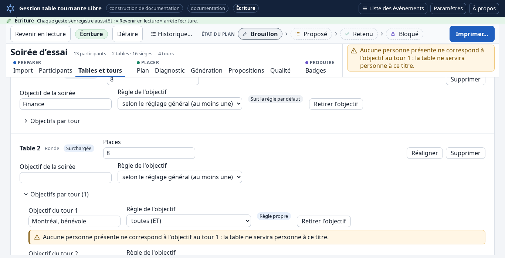

*La table 1 attend « Finance » toute la soirée, sous la règle par défaut,
que son choix nomme : « selon le réglage général (au moins une) ». Au tour 1,
la table 2 attend les personnes qui portent « Montréal » **et** « bénévole » :
« Règle propre » le dit. Aucune personne présente ne porte les deux, et le
logiciel le signale sous l’objectif. La règle par défaut se règle avec les
places par défaut et le nombre de tours ; la changer ne touche pas une règle
propre. « Retirer l’objectif » ne demande pas de confirmation : « Défaire » le
rend.*

Les objectifs s’importent aussi d’un fichier CSV, par le même aperçu que les
participants : cochez « Objectifs de table » avant de choisir le fichier.

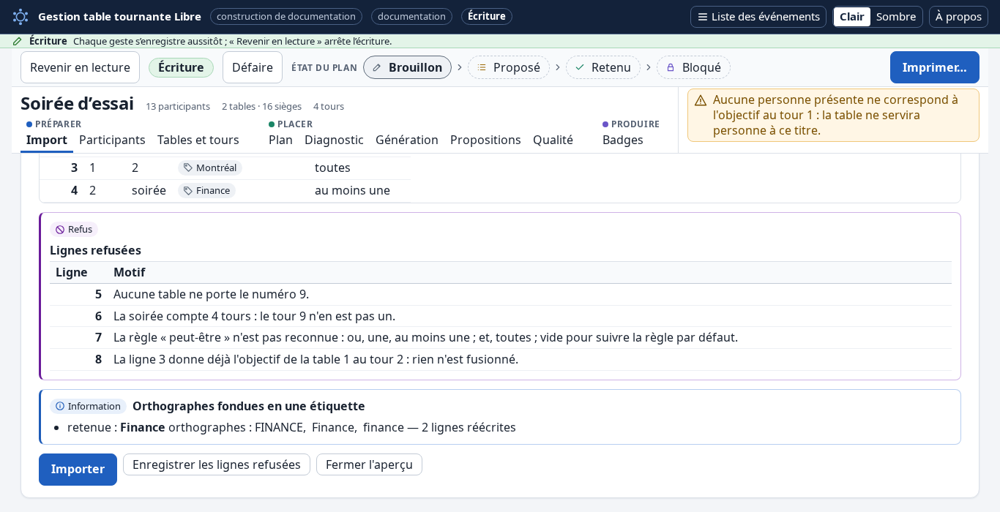

*Chaque ligne refusée dit pourquoi : une table que la soirée n’a pas, un tour
au-delà du nombre de tours, une règle inconnue, un objectif déjà donné plus
haut pour la même table et le même tour. Les orthographes d’une même étiquette
sont fondues sous celle que l’événement porte déjà. « Mettre à jour » remplace
les objectifs que le fichier nomme et garde les autres ; « Remplacer » les
retire tous d’abord, et l’annonce.*

Changer le défaut ne s’applique pas tout de suite : le logiciel annonce d’abord
la conséquence, chiffrée.

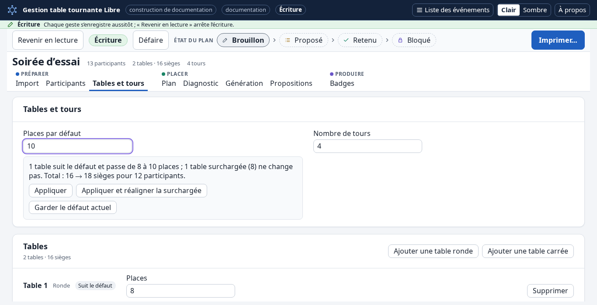

*L’annonce dit combien de tables suivent le défaut et ce qu’elles deviennent,
lesquelles, surchargées, ne changent pas, et le total des sièges contre le
nombre de participants. Choisissez « Appliquer », « Appliquer et réaligner la
surchargée » ou « Garder le défaut actuel ». Une baisse qu’une seule table
refuse est refusée en entier.*

Quand il y a plus de participants que de places, inutile de compter les
tables à ajouter : « Créer les tables… », offert dans la section tant que des
places manquent, et à côté de « Ouvrir les tables » dans l’avis des places
manquantes, déplie un petit formulaire. Saisissez le nombre de places par
table — le défaut y est déjà —, et le formulaire dit ce que la création fera,
par exemple « 22 tables de 8 places : 176 places pour 171 participants ».
« Créer » ajoute juste assez de tables de cette taille, numérotées à la suite
des vôtres, rondes, en une seule entrée de l’historique : « Défaire » ou
Ctrl+Z les retire toutes. Des tables à la taille du défaut le suivent ; d’une
autre taille, elles sont surchargées. Sous une présence partielle, le compte
est celui des personnes présentes au plus à un même tour. « Annuler » replie
le formulaire sans rien créer.

La section « Plan » montre les tables à l’échelle :

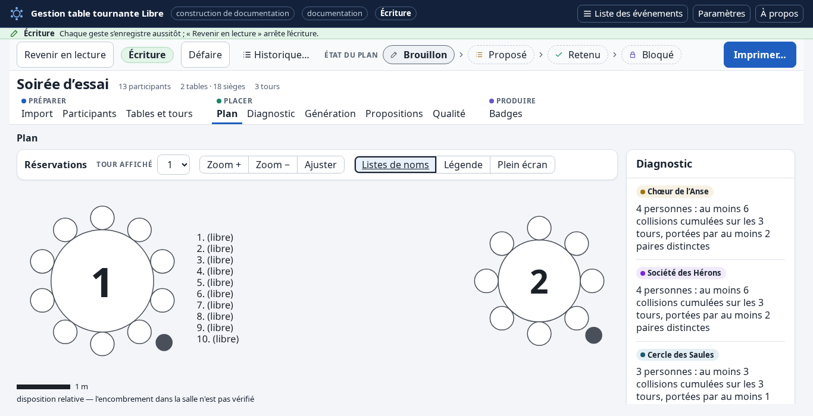

*Chaque table se dessine à sa taille réelle, avec ses sièges numérotés. Tant
qu’aucune dimension de salle n’est saisie, la mention « disposition relative »
rappelle que l’encombrement dans la salle n’est pas vérifié. Faites glisser une
table pour la déplacer ; « Ajuster » cadre le plan entier.*

Sur un grand plan, le dessin s’adapte au zoom. Zoomé, chaque siège se vise :

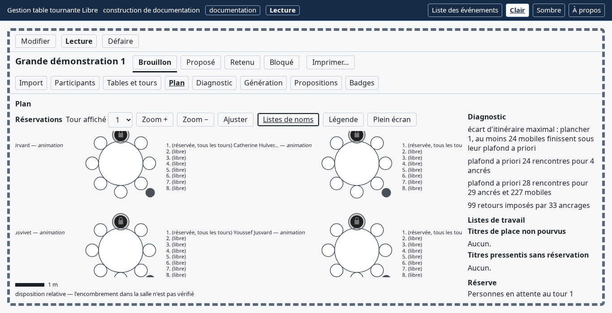

*À ce zoom, un clic ou un dépôt vise le siège sous le pointeur.*

Au zoom qui montre toute la salle, les sièges deviennent trop petits pour être
visés un par un, et c’est la table entière qui reçoit le geste :

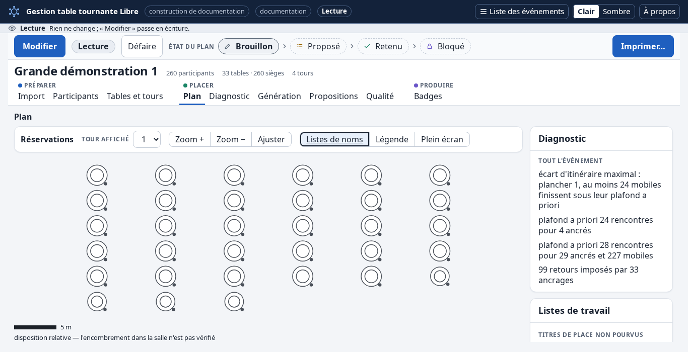

*Ici, un dépôt vise la table ; zoomez pour choisir un siège précis.*

## Étape 5 — Fixer le nombre de tours

Le nombre de tours se règle dans la même section. Retirer un tour puis le
remettre retrouve intactes les réservations valables à tous les tours. En
revanche, retirer le tour *r* détruit les réservations posées sur ce seul tour,
et le logiciel le dit **avant** d’appliquer :

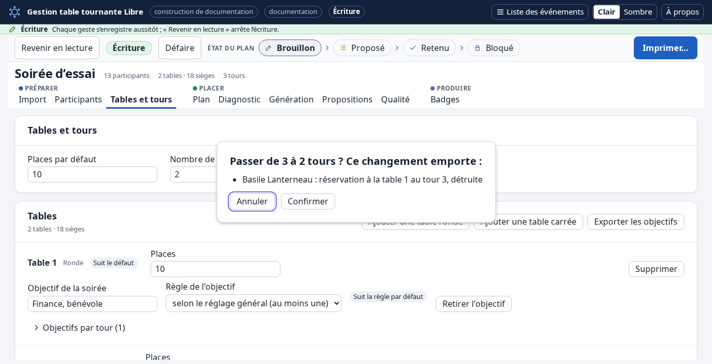

*L’annonce nomme chaque réservation détruite, avec sa personne, sa table et
son tour. « Annuler » ne change rien.*

Les placements déjà générés ne sont pas tronqués : ils restent entiers, mais ne
décrivent plus la soirée, et le logiciel nomme ceux que le changement touche.

## Étape 6 — Désigner les animateurs, table par table

Cette étape est facultative : une soirée sans animateur est valide. Le
logiciel ne répartit pas les animateurs : vous désignez vous-même **quelle
personne anime quelle table**.

Choisissez la personne — dans la « Réserve » du plan, ou par « Voir sur le
plan » depuis la grille —, puis la place : « Désigner » pose d’un seul geste une
réservation valable à tous les tours et un titre de place, par exemple
« animation ». Les deux ensemble font l’animateur. « Réserver » pose une
réservation seule, pour un tour ou pour tous ; « Donner un titre » pose un
titre seul, que personne n’occupe encore.

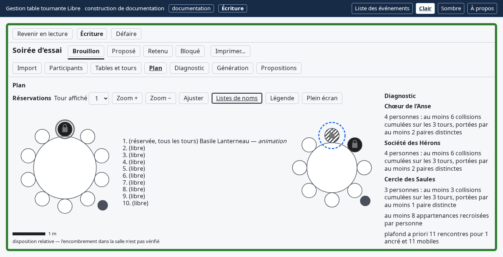

*À la table 1, le siège 1 porte un cadenas fermé et un anneau : réservé à tous
les tours, à l’animateur, et la liste des sièges l’énonce en toutes lettres,
« (réservée, tous les tours) », avec son nom et son titre. À la table 2, le
siège 1 est hachuré avec un cadenas ouvert : un titre « animation » attend son
titulaire ; le siège voisin, au cadenas fermé sans anneau, est réservé pour ce
tour. La liste de la table 2, que le bord du plan coupe ici, les énonce de
même. À droite, le panneau s’ouvre sur le diagnostic ; plus bas dans le même
panneau, les « Listes de travail » montrent ce qui reste à faire : les titres
de place non pourvus, et les personnes au titre pressenti qui ne sont
réservées nulle part.*

Les animateurs se désignent aussi en lot, depuis « Tables et tours » : sous
chaque table, la rangée « Animateurs » montre ses animateurs en pastilles, puis
« Ajouter… ». La fenêtre qui s’ouvre cherche les personnes par nom, prénom ou
organisation, sans égard aux majuscules ni aux accents, et les groupe par
organisation tant que « Grouper par organisation » est cochée. Chaque personne
porte son statut en toutes lettres — elle anime déjà une table, elle est
absente à un tour, une place lui est réservée, elle est exclue, ou elle est
placée au plan retenu — et la case
de celles qu’on ne peut pas choisir est désactivée. Cochez les personnes,
gardez ou changez le titre, « animateur » par défaut, puis « Ajouter » : elles
sont désignées ensemble, en une seule entrée de l’historique. Si une seule est
refusée, aucune ne l’est, et le refus la nomme dans la fenêtre. Le bouton de
retrait d’une pastille retire à la fois la réservation et le titre de cet
animateur.

Une table peut avoir zéro, un ou plusieurs animateurs, mais jamais plus
d’animateurs que de sièges. Une table dont tous les sièges sont réservés est
acceptée et signalée : elle ne tourne plus. Quand les sièges ne sont pas
attribués, « la place » est la table entière, qui porte un compte de titres.

## Étape 7 — Placer des participants à la main

Les mêmes gestes posent des réservations ordinaires, pour un tour ou pour tous.
Le logiciel refuse de déposer quelqu’un sur une place réservée à un autre, et
dit pourquoi sur la place même :

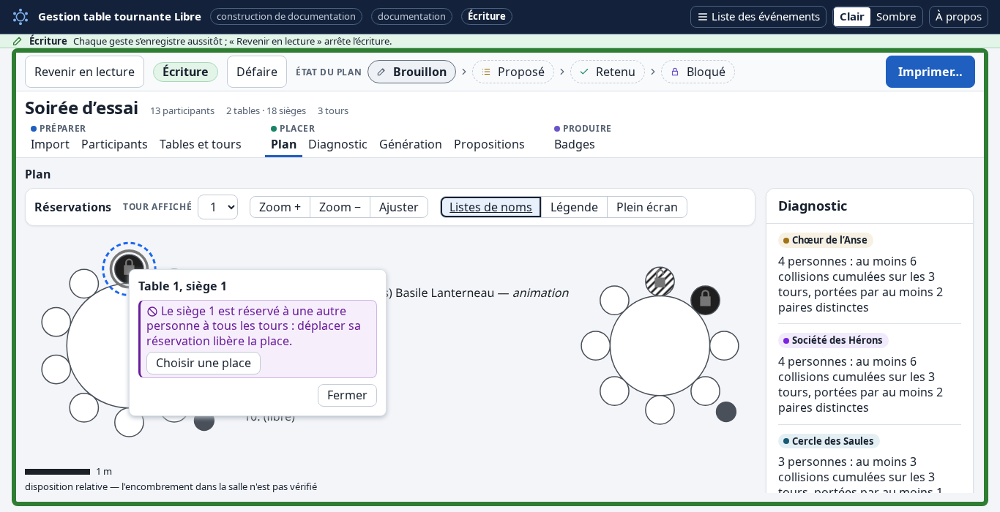

*Le refus s’affiche sur le siège visé, nomme sa cause — le siège est réservé à
une autre personne à tous les tours — et le geste qui la lève : déplacer cette
réservation. Aucune fenêtre ne s’ouvre, rien ne s’écrit.*

Déplacer une réservation est un geste à part : « Déplacer sa réservation »,
dans le menu de la personne.

Réserver une place à côté d’une personne avec qui l’on est en conflit
d’organisation n’est pas refusé : c’est votre décision. La table le signale par
des hachures horizontales, sa pastille compte la paire, et le panneau de la
table, ouvert d’un clic, la nomme sous « Conflits d’organisation à ce tour ».
Il en va de même d’un placement retouché à la main (étape 11).

## Étape 8 — Lire le diagnostic

Le diagnostic se calcule seul, avant toute recherche : il n’y a rien à
demander. Il dit ce que la configuration rend inévitable, combien, et ce qui le
rendrait évitable.

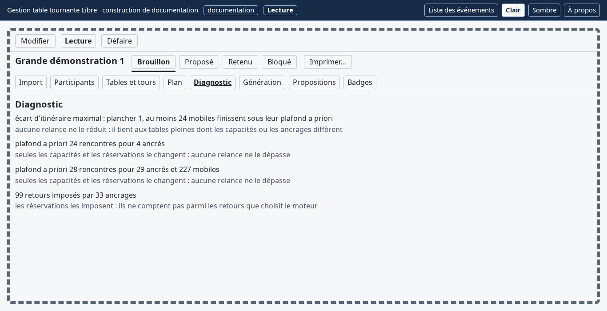

*Sur la grande démonstration, le diagnostic donne le **plafond a priori** — le
plus de personnes qu’on puisse rencontrer, ici différent pour les animateurs des
petites tables et pour les autres —, les **retours imposés** par les
réservations, comptés à part de ceux que choisit la recherche, et le
**plancher de l’écart d’itinéraire**. Chaque ligne dit ce qui la ferait bouger,
et ce qu’aucune relance ne changera.*

Sous chaque ligne, une phrase **« Concrètement : »** dit ce qu’elle signifie
avec les chiffres de votre événement. Sur 4 tours à des tables de 8 : « à une
table de 8, on rencontre 7 personnes par tour ; sur les 4 tours, 28 personnes
différentes au plus, et seulement sans jamais revoir quelqu’un ». Quand des
places restent vides, la même phrase le dit — « 4 places restent vides à
chaque tour, 260 personnes pour 264 places » sur la grande démonstration sans
exception — et rappelle qu’une personne assise à une table incomplète y
rencontre une personne de moins. Les retours imposés se lisent de même :
chacune des personnes réservées reste à sa table à chaque tour, et ces
retours, voulus, ne comptent pas contre les propositions. Quand un geste
change la ligne, il suit, précédé de **« Pour changer cela : »** — des tables
plus grandes, ou un tour de plus, pour le plafond, une table de plus pour une
organisation trop nombreuse. Une ligne qu’aucun geste ne change le dit sans
amorce.

Quand des **organisations en conflit** ne peuvent jamais partager une table,
une carte « Organisations en conflit » chiffre ce que ce partage coûte. Avec
deux organisations de 20 et 13 personnes sur 22 tables de 8 : « les
organisations « A » et « B » ne peuvent jamais partager une table : tant
qu’aucun conflit ne se produit, au moins 44 collisions cumulées sur les 4
tours (11 par tour) », alors que chacune, seule, s’assoirait sans collision.
Concrètement, chaque tour partage les tables entre elles, et chacune se serre
sur sa part ; pour changer cela, des tables de plus, ou lever le conflit dans
la colonne « Conflit d’organisation ». Le diagnostic se tait quand un membre
de ces organisations est réservé à une table, et quand les conflits de plus
de deux organisations ne passent pas tous par une seule d’entre elles.

Le diagnostic va plus loin quand il le peut : 400 millisecondes après chaque
changement de la configuration, il lance un **calcul exact** du plancher des
collisions, tour par tour, qui tient compte de toutes les organisations, des
capacités des tables et des réservations. Pendant ce calcul, une ligne sous
les cartes dit « Calcul exact du plancher des collisions… tour 2 sur 4. »,
pourquoi il se fait, et où il en est ; le bouton **« Annuler le calcul
exact »** l’arrête, et le diagnostic garde alors ses planchers habituels
jusqu’au prochain changement de la configuration. Changer un nom ou générer
des propositions ne le relance pas. Quand le calcul trouve plus que les
planchers de chaque organisation, la carte « Tout l’événement » s’ouvre sur
une ligne comme « tant qu’aucun conflit ne se produit, les tables imposent
au moins 216 collisions cumulées sur les 4 tours (54 par tour) : c’est le
minimum exact, qu’au moins un plan sans conflit atteint ». Ce minimum ne
promet pas que la meilleure proposition l’atteindra : le classement fait
passer l’excédent et les rencontres répétées avant les collisions. Un tour
trop long à prouver — chaque résolution dispose de 30 secondes — donne un
nombre « au moins », prouvé mais peut-être pas atteignable. Et quand aucun
placement ne peut séparer les organisations en conflit à un tour, la carte
« Organisations en conflit » le dit à la place de son plancher — « aucun
plan ne peut éviter tout conflit d’organisation au tour 2 » —, avec ce qui
le changerait : des tables de plus, lever un conflit ou retirer une
réservation.

Sous la carte « Tout l’événement », une dernière carte, **« La proposition
choisie »**, explique un placement : la proposition que vous montrez au plan,
sinon le placement retenu, sinon la meilleure du classement ; elle dit
laquelle. Ses phrases reprennent les chiffres de sa ligne au tableau des
propositions, en trois blocs. **Ce qui est atteint** : le moins bien servi et
son plafond a priori — par exemple « Le moins bien servi rencontre 23
personnes différentes, sur les 28 que son plafond a priori permet » —, puis,
pour chaque règle cochée, les collisions, les retours choisis, la diversité,
les objectifs et les animateurs ; une collision sans retrouvailles se dit
« toujours des paires différentes », et des collisions au plancher des
organisations en conflit ou au plancher exact, sans aucun conflit, se disent
au minimum : aucune relance ne les fera baisser sans créer de conflit. Quand
aucun plan ne peut éviter tout conflit, une proposition qui en compte le dit
aussi : une relance ne les fera pas tomber à zéro. **Ce qui manque, et
pourquoi** : ce qui sépare quelqu’un de son plafond a priori, partagé entre la
place — une table incomplète, le nombre de places vides à chaque tour — et les
revoirs — les personnes à qui il manque une rencontre, les paires qui se
croisent deux fois. Quand le diagnostic prouve qu’aucun placement n’atteint le
plafond a priori de tout le monde, la carte le dit « hors d’atteinte ».
**Ce qu’on peut tenter** : « Repartir d’elle » avec un compte d’arrêt plus
élevé quand des revoirs, la place ou une règle cochée coûtent plus que
l’inévitable, les tables quand ce sont les places vides — des tables pleines
les retirent, et si leurs capacités diffèrent alors, le diagnostic dit ce
qui demeure —, et « Rien pour les rencontres » quand la proposition atteint
le plafond de chacun. Sans proposition, comme sur la capture, la carte invite
à en générer une ; une proposition en dérive le dit, sans chiffres.

Le même diagnostic s’affiche à côté du plan, pendant que vous préparez les
tables : chaque organisation trop nombreuse pour ses tables y annonce les
retrouvailles qu’elle imposera.

## Étape 9 — Générer

Dans la section « Génération », réglez au besoin la **graine**, le nombre de
**propositions par génération** et le **compte d’arrêt**, puis cliquez sur
« Générer ». Les réservations des étapes 6 et 7 sont honorées ; la recherche
place les autres personnes autour.

Un événement neuf propose **20 propositions** par génération, un compte
d’arrêt de 2 000 000 mouvements et un historique d’acceptation de 1 000 ; un
événement existant garde les réglages qu’il porte (annexe A).

Les propositions montrées ci-dessous, et les écrans qui en découlent aux étapes
10 et 11, viennent d’une génération faite avec la graine 4242, 5 propositions
par génération, un compte d’arrêt de 300 et un historique d’acceptation de
1 000, sous les objectifs de l’étape 4 et l’ordre des priorités montré
ci-dessous ; les autres réglages gardent leur valeur par défaut. Le nombre de
propositions et le compte d’arrêt par défaut, bien plus grands, cherchent plus
longtemps et donnent d’autres propositions : écrivez ces quatre valeurs pour
retrouver les mêmes.

Les **cœurs de calcul** sont automatiques par défaut, un par processeur
logique du poste ; vous pouvez aussi en fixer le nombre. Ce réglage vaut pour la
séance, sur ce poste, et ne s’enregistre pas dans l’événement. Le logiciel
affiche la durée du dernier calcul et estime celle de la prochaine génération ;
une génération qui s’annonce longue demande d’abord confirmation. Tant
qu’aucune durée n’est mesurée dans la séance, les 20 propositions par défaut
la demandent aussi sur les postes de moins de dix processeurs logiques.

Chaque génération **ajoute** ses propositions aux précédentes, et un seul
classement les ordonne toutes. Le logiciel marque dans l’historique l’instant
qui précède chaque génération, pour y revenir.

Au même endroit, l’**ordre des priorités** dit ce que la recherche poursuit
d’abord et ce que le classement compare. Par défaut, chaque critère est seul à
son palier. Les boutons d’un critère le montent ou le descendent d’un palier,
ou le joignent au palier du dessus, où chacun reçoit un poids ; « Rétablir
l’ordre par défaut » revient au départ. Un critère que ses cases ne cochent
pas garde son rang, mais ne compte nulle part. Survoler le nom d’un critère, ou
l’atteindre avec Tab, ouvre une bulle d’aide qui dit ce qu’il compte ; Échap la
referme.

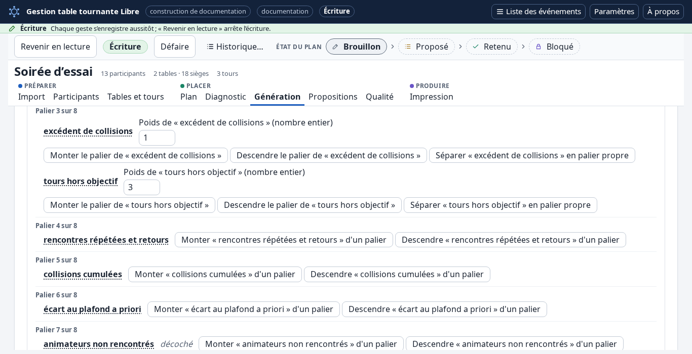

*Ici, l’excédent de collisions et les tours hors objectif partagent le
palier 2, aux poids 1 et 3 : le classement y compare l’excédent plus trois
fois les tours hors objectif. « Animateurs non rencontrés » est marqué
« décoché » : la case « Rencontrer le plus d’animateurs différents » ne l’est
pas. Au-dessus de la liste, hors de l’image, le choix « Objectifs des
tables : chercher d’abord » reste à son défaut, « le plus de places
servies ».*

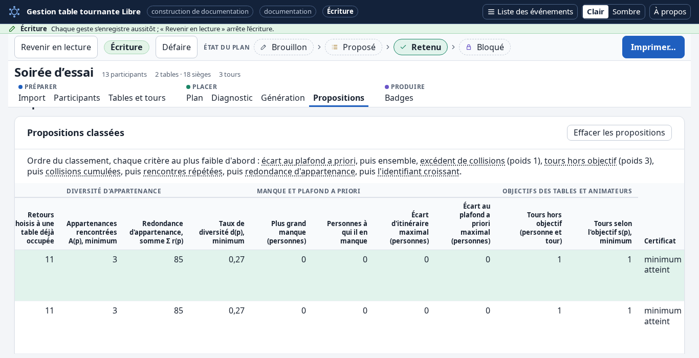

*Le tableau range les propositions selon l’ordre écrit au-dessus de lui,
celui des priorités réglé plus haut : d’abord, ensemble, l’excédent de
collisions et les tours hors objectif avec leurs poids, puis les rencontres
répétées, et ainsi de suite, chaque critère au plus faible d’abord. Plus
large que l’écran, le tableau défile de côté ; il est montré ici défilé vers
la droite : la diversité des organisations rencontrées, le manque et le
plafond a priori, puis, en dernier groupe, les objectifs des tables — les
tours hors objectif et le moins de tours servis selon l’objectif. À sa
gauche, hors de l’image, viennent le rang, la proposition, les personnes
distinctes rencontrées, les collisions entre personnes d’une même
organisation et les rencontres répétées.*

### Repartir d’une proposition

Une proposition presque à votre goût peut servir de **départ**. « Repartir
d’elle », dans le menu « Actions » de sa ligne du tableau classé, la choisit
et ouvre la section « Génération » : la carte du départ nomme la
proposition et offre une case par tour. Un tour coché est **figé** : chaque nouvelle proposition le
reprend tel quel du départ, table par table. « Générer » se lit alors
« Générer depuis n° » suivi du numéro du départ : la génération part du plan
du départ et ne refait que les tours non figés. Figer tous les tours ne laisse rien à refaire, et
le lancement le refuse. « Repartir de zéro » retire le départ et rend
« Générer ». Choisir le départ et cocher un tour n’écrivent rien, en lecture
comme en écriture : seul le lancement écrit.

Le départ doit être encore dans la liste, et ses tables celles de la
soirée : une table ajoutée ou supprimée, une capacité changée, des tours
ajoutés ou retirés, une réservation posée depuis dont il n’assied pas la
personne à sa table, et le lancement est refusé, avec « Repartir de zéro »
pour remède. Un tour figé qui n’assied pas une personne au siège que sa
réservation lui fixe est refusé lui aussi : décocher ce tour suffit.

Les deux écrans qui suivent viennent de la grande démonstration sans
exception, générée avec la graine 4242 et un compte d’arrêt de 2 000 ; sa
proposition n° 4, première du classement, sert de départ, son tour 1 figé,
à une génération faite avec la graine 389.

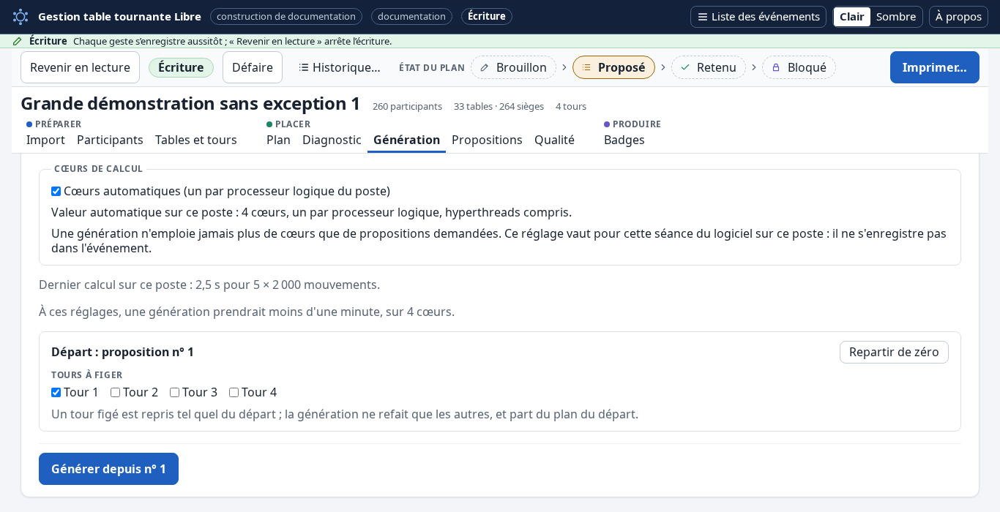

*La proposition n° 4 choisie pour départ par « Repartir d’elle », dans le
menu « Actions » de sa ligne. Sa carte
offre « Repartir de zéro » et une case par tour, le tour 1 coché ; la note
dessous rappelle ce qu’un tour figé devient. « Générer depuis n° 4 » lance
la génération ; jusque-là, rien ne s’est écrit.*

Les propositions ainsi obtenues sont des **dérivées**. Elles entrent au même
classement que les autres, et chacune porte, sous son numéro, la proposition
dont elle part et ses tours figés. L’historique nomme la génération :
« Généré 5 propositions dérivées de n° 4 (n° 6 à 10), tour 1 figé ». À la fin
du calcul, la section dit la place de la meilleure dérivée et celle du
départ, et offre « Comparer n° 6 à n° 4 », qui ouvre la vue de comparaison
de la page « Qualité » (étape 10). Une dérivée identique à son départ, ou à
une autre proposition, est écartée ; quand toutes égalent leur départ, la
section dit que le départ n’avait rien à reprendre. Le départ reste choisi après la
génération : une génération ordinaire passe par « Repartir de zéro ».

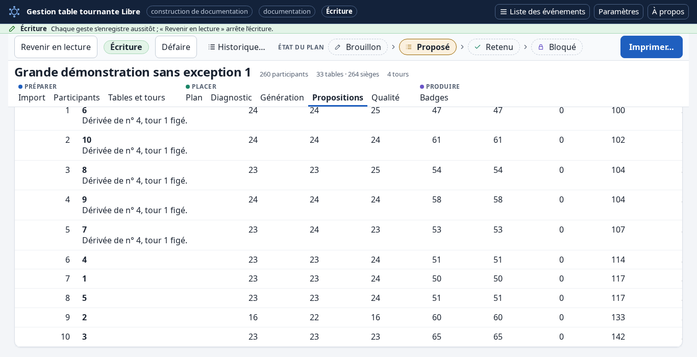

*Après la génération dérivée : la proposition n° 7, cinquième du
classement, porte « Dérivée de n° 4, tour 1 figé. » sous son numéro ; son
départ, n° 4, la suit au sixième rang du même classement. Chaque dérivée
reprend le tour 1 de n° 4, table par table. Le menu « Actions » de chaque
ligne, à droite, est hors de l’image.*

**Un changement de participants ne demande pas de repartir de zéro.** Une
proposition que l’ajout, l’exclusion, la réintégration, la suppression ou la
présence d’une personne a mise en dérive ne se classe plus, mais son menu
garde « Repartir d’elle ». La génération part alors de son plan ajusté à la
soirée telle qu’elle est : une personne absente à un tour, exclue ou
supprimée y quitte sa chaise, qui reste libre ; une personne présente que le
départ n’assied pas est à asseoir. Aux tours non figés, la recherche
l’assied ; aux tours figés, personne ne bouge : une arrivée y prend la
meilleure chaise libre, ou attend en réserve quand sa table ou son siège
réservé n’en a plus.

L’écran qui suit vient de la petite démonstration, générée avec la graine
4242 et sa proposition n° 1 retenue. Une personne y est ensuite dite
présente aux tours 1 et 2, une autre ajoutée aux tours 3 et 4 ; n° 1, en
dérive, sert de départ, ses tours 1 et 2 figés.

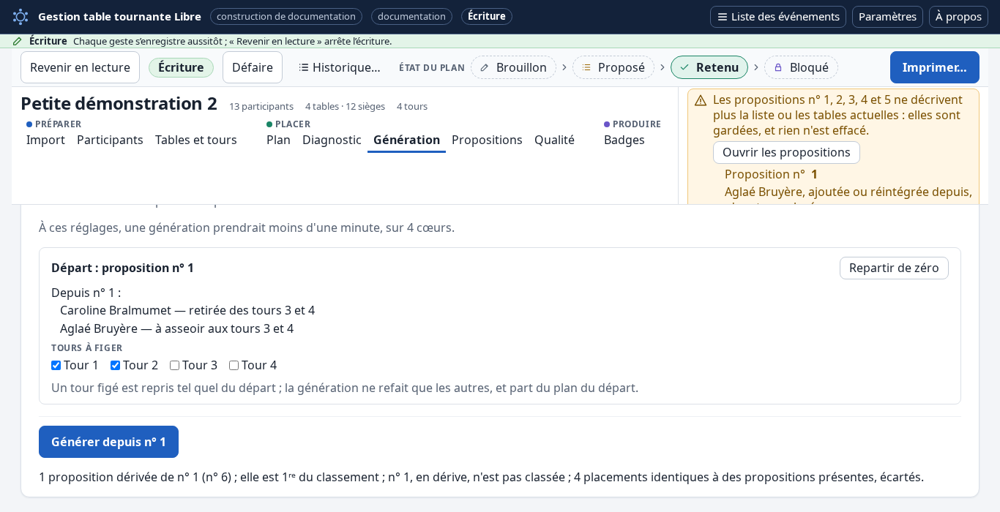

*Sous le titre du départ, ses écarts à la soirée, nommés avant le lancement :
la personne retirée des tours 3 et 4, où elle est absente, et l’arrivée, à
asseoir à ces tours. Après le calcul, l’issue nomme la meilleure dérivée et
dit que n° 1, en dérive, n’est pas classée ; les dérivées, elles, décrivent
la soirée et entrent au classement. Quand le placement retenu vient de ce
départ et qu’un de ses tours figés diffère du départ ajusté à la soirée —
une retouche à la main, ou une personne partie puis revenue —, le lancement
avertit que ce tour du retenu n’y est pas : un tour figé vient de la
proposition, non du retenu.*

Tant que le classement compte moins de 10 propositions, « Garder les 10
meilleures » refuse d’effacer une proposition qui sert encore de départ sans
avoir été comparée : générez des dérivées jusqu’à en classer 10, ou gardez-en
moins.

## Étape 10 — Comparer, et retenir

Comparer se fait dans le [tableau classé](doc/captures/11-propositions.png) de
la section « Propositions ». La première ligne est la meilleure selon le
classement ; les colonnes du **manque** — « Plus grand manque », « Personnes à
qui il en manque », « Écart d’itinéraire maximal » — permettent de comparer deux
propositions même quand des tables sont incomplètes (voir « Comment le logiciel
cherche », plus bas). « Imposé par les réservations » sépare ce que vos
réservations imposent de ce que la recherche a choisi. Quand des personnes
nomment des organisations en conflit, une colonne compte les conflits
d’organisation de chaque proposition, et une ligne qui en garde le dit sous son
numéro : « 2 conflits restants ». Pour deux placements précis, la vue
« Comparaison » de la page « Qualité », plus bas, les met côte à côte.

Les commandes d’une ligne sont dans son menu : cliquez « Actions », au bout de
la ligne, puis la commande ; au clavier, Entrée ou les flèches ouvrent le menu.
« Voir sur le plan » montre une proposition sur le plan, sans rien écrire.
« Retenir » en fait le **placement retenu** : l’état du plan passe à
« Retenu », et les autres propositions restent dans la liste. Retenir une autre
proposition alors que le retenu a été ajusté à la main détruit ces ajustements :
une fenêtre le dit avant. Un retenu seulement ajusté aux participants
(étape 11) se remplace sans fenêtre, et la copie retenue s’ajuste à son tour
à la présence de chacun.

La liste des événements résume ensuite le retenu par ses collisions cumulées
(paire et tour) et ses rencontres répétées choisies (paires), les nombres du
tableau des propositions.

Ces chiffres, et la meilleure proposition de chaque événement, paraissent dès
l’ouverture de la liste : la dernière vue d’ensemble de chaque événement est
gardée à côté de son fichier d’état, dans `<nom>.gtt-apercu.json`. Quand
l’événement a changé depuis, son ancien chiffre paraît atténué, le signe de
chargement qui tourne à côté — « Chiffre de la dernière vue d’ensemble, en
cours de vérification » au survol —, le temps que la liste le recalcule en
arrière-plan, sans bloquer la page ; un événement qui n’a pas encore de vue
d’ensemble montre le signe seul. Ce fichier n’est qu’un raccourci : l’effacer
ne perd rien, la liste le refait. Copier ou importer un événement ne le
recopie pas.

Retenir n’est pas obligatoire, mais tout ce qui s’imprime sans placement retenu
porte la mention BROUILLON (étape 12).

### La page « Qualité »

Avant de retenir, la section « Qualité » dit si un placement est bon, et qui
y est mal servi. La commande « Qualité », dans le menu « Actions » de chaque
ligne du tableau classé, montre la proposition sur le plan et ouvre la page ; sans proposition
montrée, la page mesure le placement retenu. Sa première ligne dit toujours
quel placement elle mesure. Regarder la page n’écrit rien : elle se lit en
lecture comme en écriture.

Chaque graphique a son tableau jumeau, que « Voir le tableau » ouvre : les
mêmes nombres, ligne par ligne, au clavier et au lecteur d’écran. Un
pourcentage est toujours suivi du compte qu’il résume : le pire cas d’une
population, ou le compte de sa ligne.

Les écrans de la grande démonstration viennent d’une génération faite avec
la graine 4242 et un compte d’arrêt de 2 000 ; ceux de la petite
démonstration, avec la graine 4242 et le compte d’arrêt par défaut ; les
autres, avec la graine 4242 et un compte d’arrêt de 300.

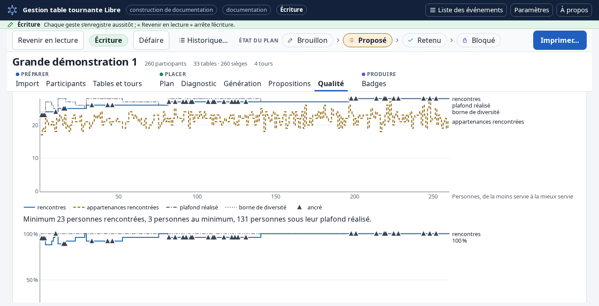

*Le profil trié de la première proposition de la grande démonstration. En
haut, en comptes de personnes : les rencontres de chacun en trait plein, de
la personne la moins servie, à gauche, à la mieux servie ; les organisations
rencontrées en tirets ; le plafond réalisé en trait mixte et la borne de
diversité en pointillés, chacun nommé au bout de son tracé. Les triangles
marquent les personnes ancrées par une réservation. Dessous, au même ordre
de rangs, les rencontres de chacun en pourcentage de son plafond réalisé,
sous la règle à 100 % ; le bas de ce second graphique sort de l’image.
Le pire cas est au premier rang des deux graphiques.*

La vue suivante, « Comparaison », répond à une autre question : laquelle de
deux propositions sert mieux, et qui y perd ? Elle oppose le placement que la
page mesure à un second, choisi dans la liste « Comparer à : » ; pour une
dérivée, c’est d’abord son départ. « Comparer », dans le menu « Actions »
d’une ligne du tableau classé, ouvre la vue avec cette ligne. Les chiffres des deux viennent
d’abord, en deux colonnes : la place au classement, le minimum brut en
pourcentage avec le compte du pire dessous, comme sur les tuiles, le plus
grand manque, les personnes à qui il en manque, l’écart d’itinéraire ;
« Tous les indicateurs » déplie les autres. Puis le manque des deux,
superposé sur un même axe : chaque placement rangé de son plus grand manque
au plus petit. Les phrases comptent les rangs où chacun sert mieux, et
nomment le rang où l’avantage change de côté quand il n’en change qu’une
fois. Le tracé, ses phrases et son tableau jumeau sont en comptes, jamais en
pourcentages. La vue ne fait que regarder : elle n’écrit rien.

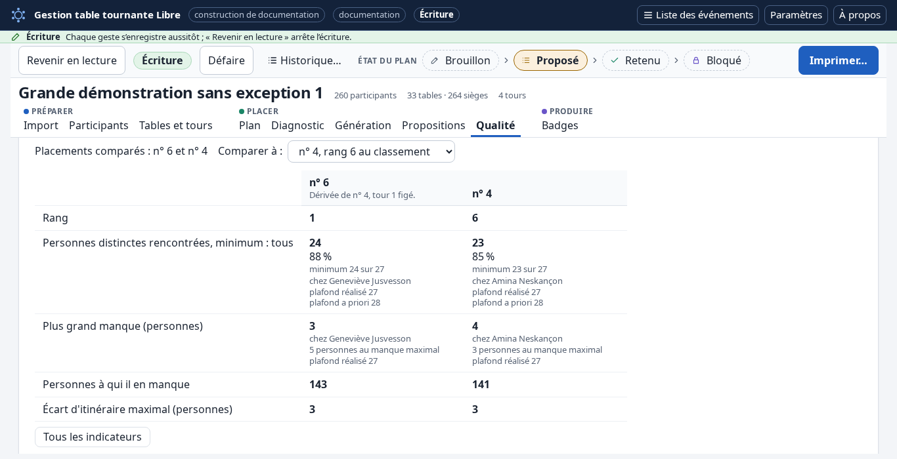

*Les colonnes de la meilleure dérivée, n° 6, sa filiation sous son nom, et de
son départ, n° 4, sur la grande démonstration sans exception. Le minimum brut
s’écrit 88 % et 85 %, chacun avec le compte du pire dessous, « minimum 24 sur
27 » et « minimum 23 sur 27 » ; suivent le plus grand manque, 3 et 4, les
personnes à qui il en manque, 143 et 141, et l’écart d’itinéraire, 3 des deux
côtés. Aucun écart n’est calculé entre les deux colonnes, et aucune n’est mise
en évidence. « Tous les indicateurs », replié dessous, garde les autres
chiffres. La question de la vue, juste au-dessus, est hors de l’image.*

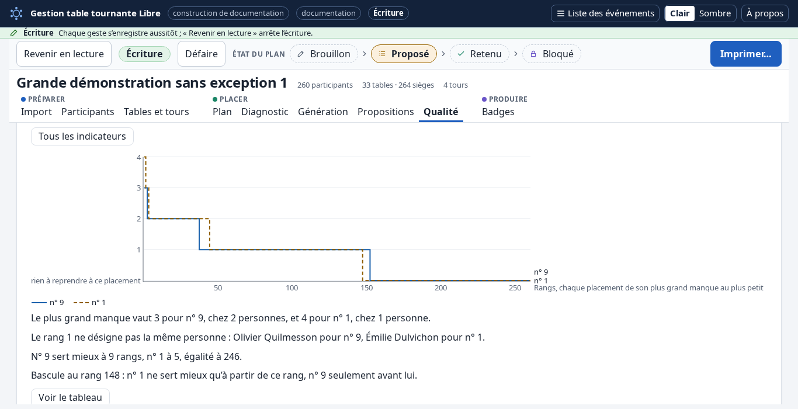

*La meilleure dérivée, n° 6, en trait plein, contre son départ, n° 4, en
tirets : la même vue, sous ses colonnes de l’image précédente. Le zéro de
l’axe se lit « rien à reprendre à ce placement ». N° 4 laisse trois
personnes à quatre rencontres de son plafond réalisé, n° 6 personne au-delà
de trois ; les courbes se croisent au rang 142, d’où n° 4 sert mieux. Les
phrases le disent en comptes de rangs.*

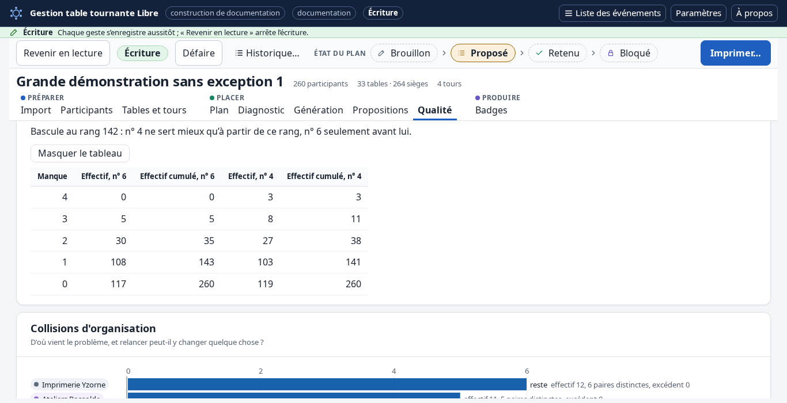

*L’escalier du manque, ouvert par « Voir le tableau » : pour chaque valeur
de manque, de la plus grande à zéro, le nombre de rangs qui la prennent dans
chaque placement, et l’effectif cumulé, le nombre de rangs qui l’atteignent
ou la dépassent — le dernier rang où la courbe atteint cette valeur.*

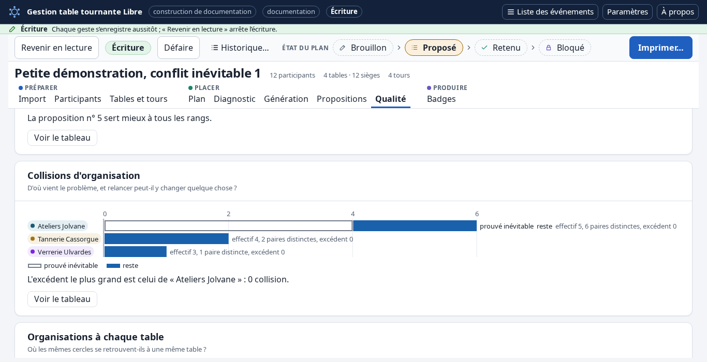

*Les collisions d’organisation de la variante « conflit inévitable » : une
barre par organisation, le plus grand excédent d’abord. Pour
l’organisation de cinq personnes, à quatre tables, le segment gris « prouvé
inévitable » vaut 4 collisions cumulées, le plancher que le diagnostic
annonce ; le segment bleu « reste » est ce que la recherche aurait pu
éviter. L’effectif, les paires distinctes et l’excédent suivent en encre
secondaire.*

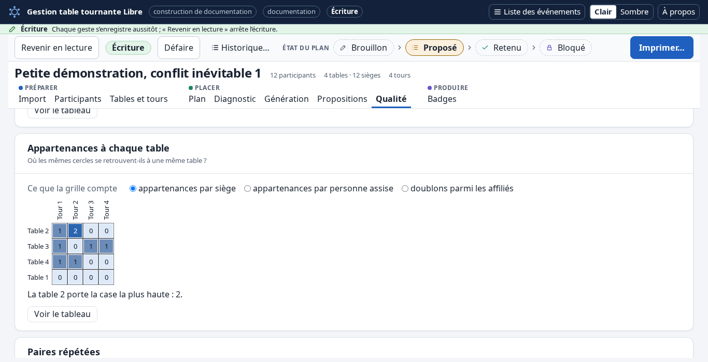

*Les organisations à chaque table, même proposition. Le sélecteur est sur
« organisations par siège » : une ligne par table, une colonne par tour, et
chaque case écrit le nombre de sièges qui n’apportent aucune organisation
nouvelle à leur table ; sa couleur fonce avec lui. La pire table vient en
tête : ici la table 2, qui en compte un à chaque tour, et la phrase sous la
grille la nomme. Aucune case ne dépasse 1 : la grille n’a que deux teintes,
celle de 0 et celle de 1. Les deux autres positions comptent les personnes
assises, puis les doublons parmi les personnes d’une organisation ; le choix
tient le temps de la séance, et n’écrit rien.*

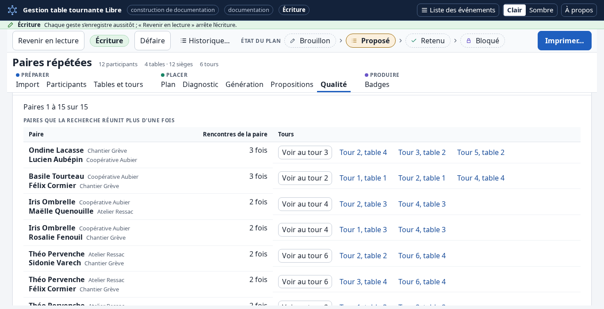

*Les paires répétées d’une soirée construite de 12 personnes, 4 tables de
3 places et 6 tours, où se revoir est forcé : les paires les plus revues
d’abord. « Voir au tour … » montre le plan au premier tour où la paire se
revoit ; chaque tour et sa table sont aussi une commande vers le plan.*

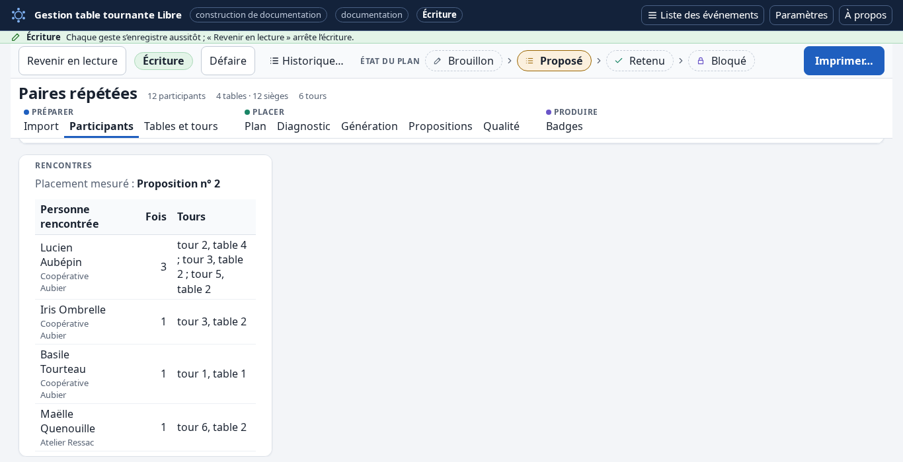

*La fiche d’une personne de la même soirée, sa rubrique « Rencontres » : qui
elle a rencontré, combien de fois, à quels tours et à quelles tables, les
plus revues d’abord. Ses rencontres de plus d’une fois sont ses lignes du
tableau des paires.*

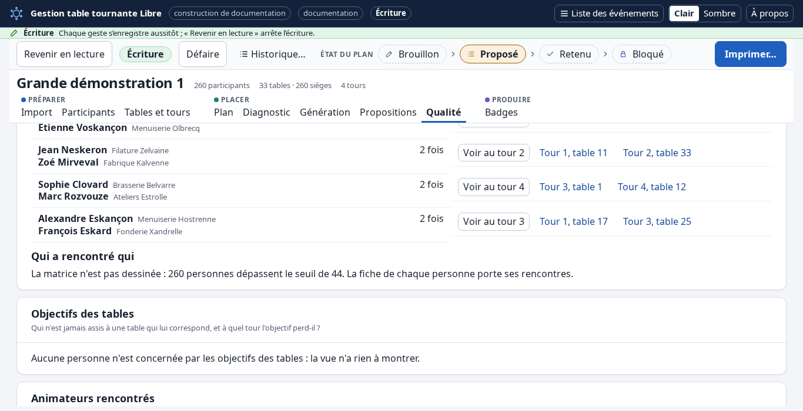

*Sur la grande démonstration, la matrice « qui a rencontré qui » n’est pas
dessinée : 260 personnes dépassent son seuil, et la phrase renvoie à la
fiche de chaque personne. Au-dessus, la fin du tableau des paires
répétées.*

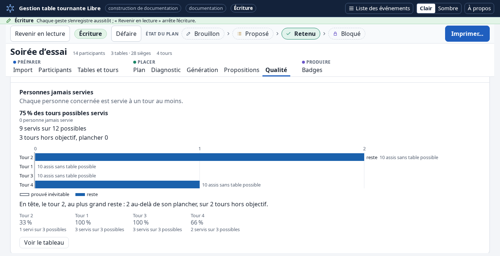

*Les objectifs des tables de la « Soirée d’essai », changée depuis
l’étape 9 et générée de nouveau : d’abord les personnes jamais servies —
aucune ici —, puis la soirée en texte, sa part des tours possibles servis
et, dessous, le compte des jamais servies ; puis une barre par tour, le tour
au plus grand reste en tête, chacune avec ses assis sans table possible en
encre secondaire ; enfin chaque tour, son pourcentage et ses deux comptes.
Aucun avertissement ne s’affiche : aucun placement de la soirée ne contredit
sa liste.*

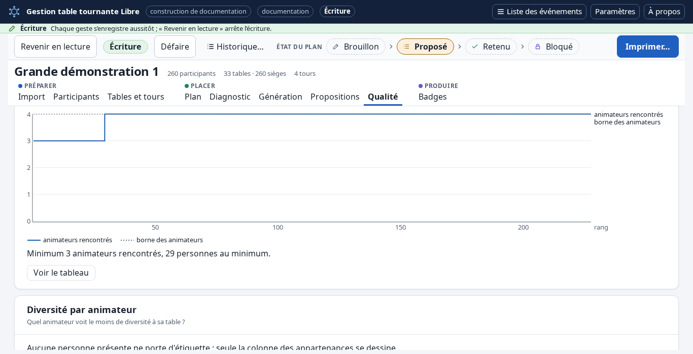

*Les animateurs rencontrés sur la grande démonstration : chaque personne
concernée, de la moins servie à la mieux servie, sous la borne des
animateurs en pointillés — ce que la soirée permet au mieux, sans garantie.
Dessous commence la diversité par animateur : aucune personne présente ne
porte d’étiquette, et seule la colonne des organisations se dessine.*

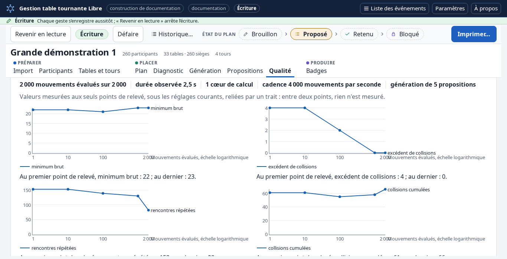

*La performance du calcul de la proposition montrée, dans la séance qui l’a
générée : les mouvements évalués sur le compte d’arrêt, puis la durée
observée, les cœurs, la cadence et le nombre de propositions de la
génération entière. Chaque petit multiple porte une valeur aux seuls points
de relevé — après 1, 10, 100 et 1 000 mouvements, puis au dernier, la
proposition elle-même —, sur une abscisse logarithmique ; entre deux
points, rien n’est mesuré. Ici, plusieurs valeurs changent encore au
dernier point ; la phrase qui nomme le dernier changement suit les petits
multiples, plus bas, hors de l’image. Rouvert plus tard, l’événement garde
la course, et la durée devient « inconnue » : elle ne valait que pour la
séance.*

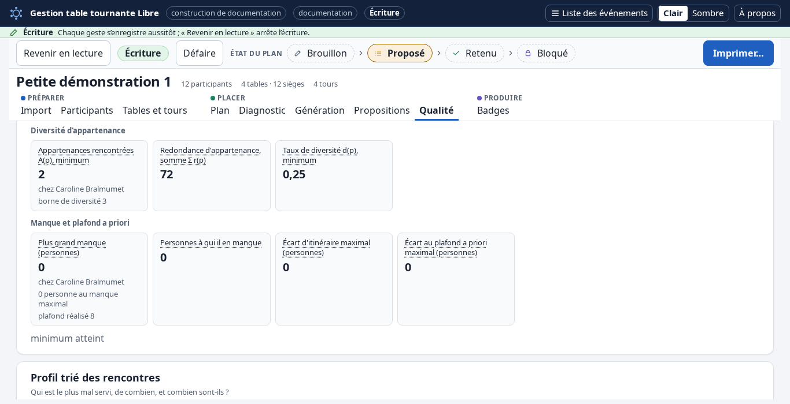

*Le bas de l’en-tête chiffré, sur la petite démonstration générée au compte
d’arrêt par défaut : la diversité d’organisation, aucun manque, et « minimum
atteint ». Plus haut, hors de l’image, les collisions cumulées et les
rencontres répétées valent 0, et la ligne des ancrés écrit « — » : la
démonstration n’a aucune réservation, et une population vide n’a pas de
minimum.*

#### Quand il n’y a rien à dessiner

La page ne dessine jamais d’axes vides : un cas qui n’a rien à montrer le
dit par une phrase. Chacun des sept écrans suivants vient de sa propre
configuration : la variante « conflit inévitable », ou une courte soirée
construite à la main.

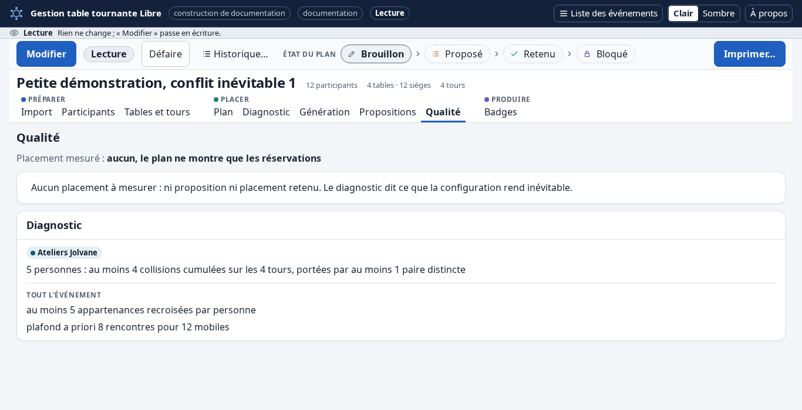

*Aucun placement : la variante « conflit inévitable », avant toute
génération. La page dit qu’il n’y a rien à mesurer, et montre le diagnostic
préalable : au moins 4 collisions cumulées pour l’organisation de cinq
personnes, à quatre tables.*

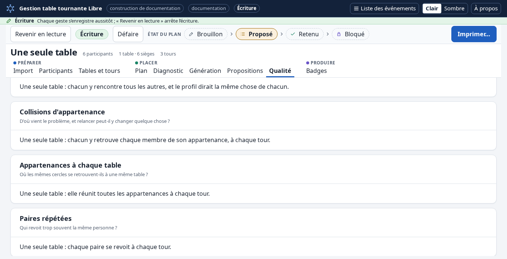

*Une seule table de six places, six personnes, trois tours : chacun y
rencontre tous les autres. Le profil, les collisions, les organisations à
chaque table et les paires cèdent chacun la place à sa phrase.*

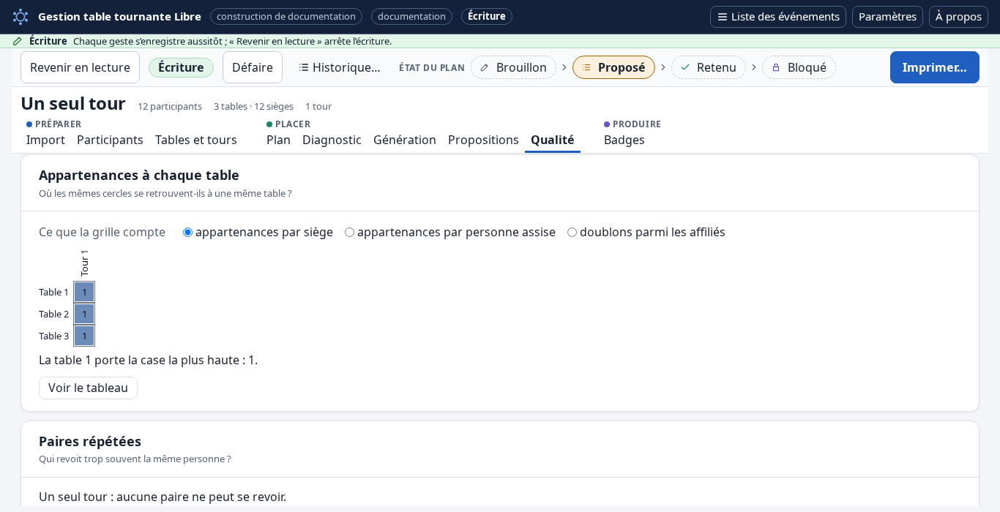

*Un seul tour, douze personnes à trois tables de quatre : le profil et les
collisions se dessinent plus haut, hors de l’image ; la vue des tables, son
sélecteur sur « organisations par siège », n’a qu’une colonne, et aucune
paire ne peut se revoir.*

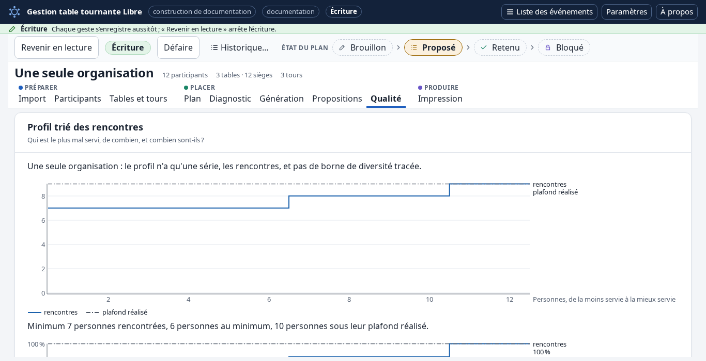

*Douze personnes d’une même organisation : le profil n’a qu’une série, les
rencontres, sans borne de diversité, et sa phrase le dit. Les collisions et
la grille des tables restent, plus bas.*

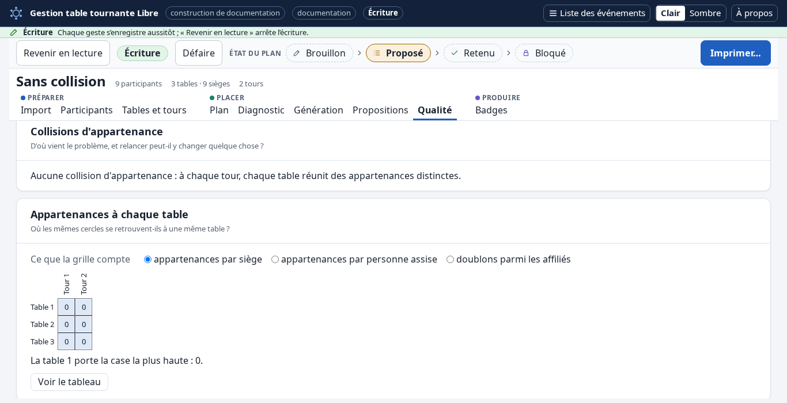

*Neuf personnes de neuf organisations, trois tables de trois, deux tours :
aucune collision, et la phrase le dit. La grille, sous « organisations par
siège », écrit 0 dans chaque case.*

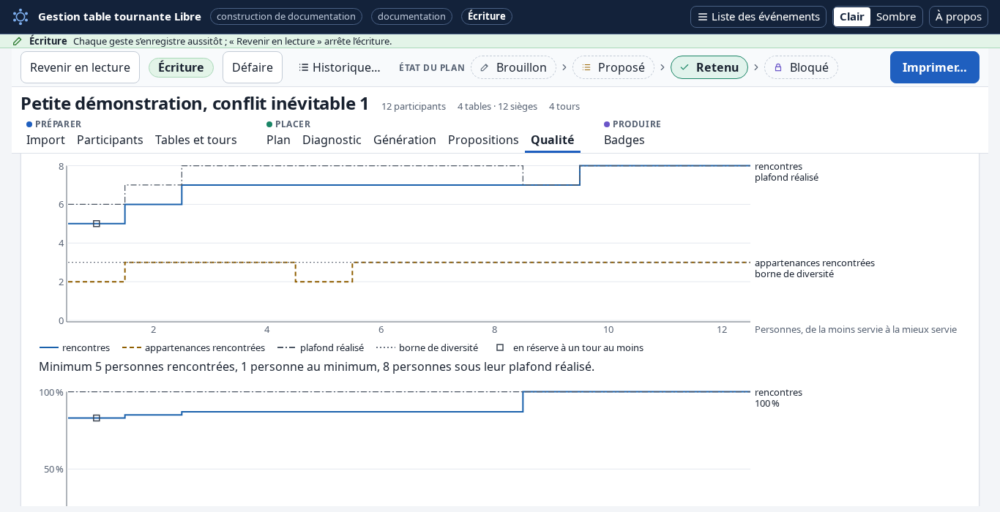

*La variante, sa première proposition retenue, puis une personne retirée du
tour 2 sur le plan : le carré la marque, dans les deux graphiques du
profil, en réserve à un tour au moins. Plus bas, hors de l’image, les
collisions n’ont plus qu’un segment : le plancher du diagnostic ne vaut que
pour un plan qui assoit chacun à chaque tour, et une phrase le dit.*

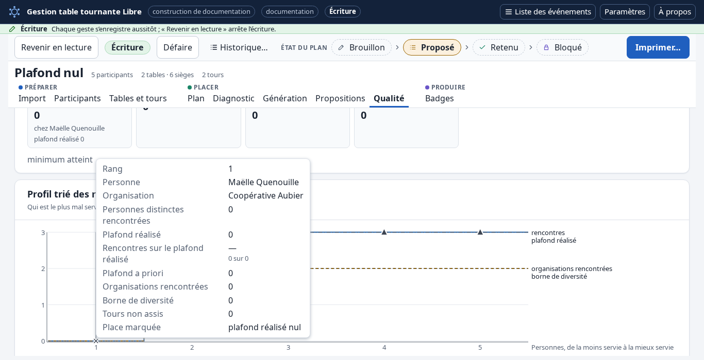

*Cinq personnes, une table de quatre et une de deux, deux tours ; quatre
sont réservées à la table de quatre. La cinquième, assise seule à la table
de deux, ne peut rencontrer personne : son plafond réalisé est nul. Au
premier rang du profil, son infobulle écrit le plafond réalisé 0 et le
pourcentage « — » ; au second graphique, plus bas, ce rang n’a pas de
point.*

Une personne absente à un tour ne compte pas ce tour : ses rencontres, son
plafond et ses tours servis se lisent sur ses tours de présence. Le profil la
marque d’un losange creux, « absente à un tour au moins », et son infobulle
dit à combien de tours.

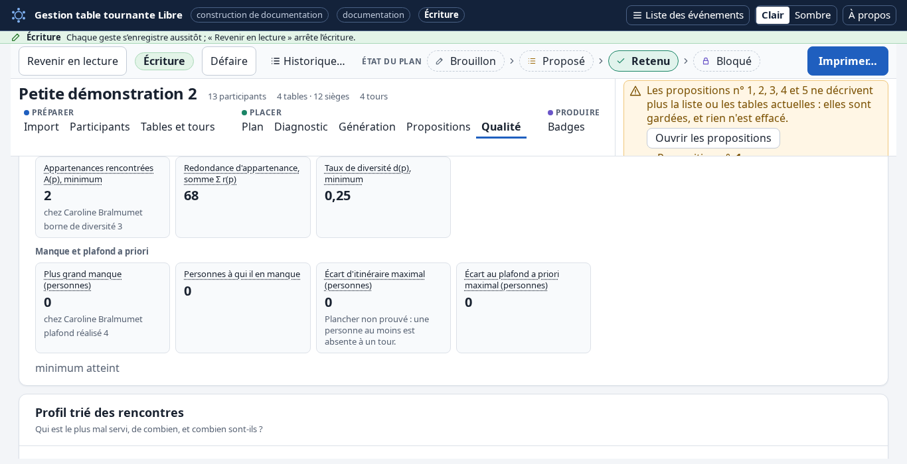

*La meilleure dérivée de l’étape 9, sous l’absence de deux personnes. La
tuile de l’écart d’itinéraire maximal dit que son plancher n’est pas prouvé :
sa preuve suppose chacun présent à chaque tour. Les autres planchers se
calculent tour par tour sur les personnes présentes, et restent ; plus bas,
hors de l’image, les collisions gardent leur segment « prouvé inévitable ».
La personne qui a le moins de rencontres est souvent une présence
partielle : l’infobulle de la tuile du minimum le dit.*

## Étape 11 — Ajuster à la main

Sur le placement retenu, le geste de l’étape 7 déplace maintenant une personne
réelle, au tour affiché. **Le geste est le même, ce qu’il change ne l’est pas,
et l’interface le dit** pendant que vous faites glisser :

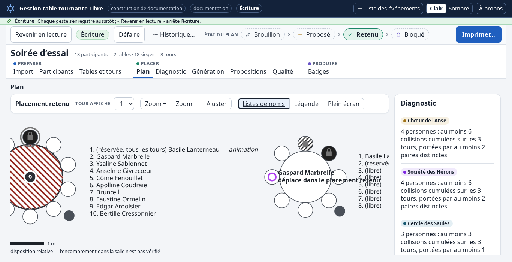

*Pendant le glissement, l’étiquette qui suit le pointeur dit « déplace dans le
placement retenu » : la personne change de place dans le plan qui sera
imprimé, sans poser de réservation. Le titre du plan, « Placement retenu »,
dit quel placement vous regardez.*

Les indicateurs du tableau des propositions suivent l’ajustement.

**Le placement retenu suit qui est là.** Changer la présence d’une personne,
l’ajouter, l’exclure, la réintégrer, la supprimer ou importer la liste ajuste
le retenu dans le même geste : une personne absente à un tour quitte sa
chaise, qui reste libre ; une personne présente qu’il n’asseyait pas attend
dans la réserve de ce tour. Personne d’autre ne change de place, et le retenu
ne dérive pas.

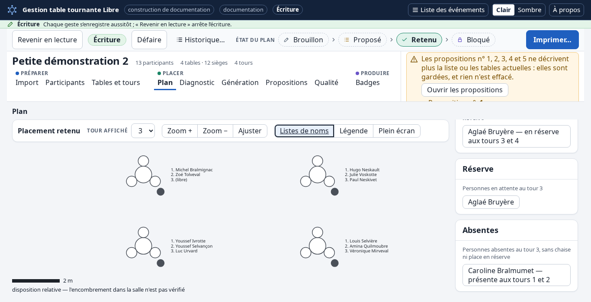

*Au tour 3 de la petite démonstration, la personne partie après le tour 2 a
laissé sa chaise libre ; la carte « Absentes », sous la réserve, la nomme
avec ses tours de présence, et son bouton ouvre sa fiche, où sa présence se
change. L’arrivée attend dans la réserve. La liste « En réserve dans le
placement retenu », en haut à droite, la nomme avec ses tours : un clic
montre le premier et la choisit, pour l’asseoir d’un geste ; une
proposition dérivée (étape 9) l’assied aussi.*

Exclure ou supprimer une personne assise au retenu la retire aussi des tours
déjà joués, et le logiciel l’avertit : ses rencontres de ces tours n’y
comptent plus. Pour les garder, défaites, puis réduisez plutôt sa présence
aux tours où elle était là.

En lecture, aucun de ces gestes ne passe :

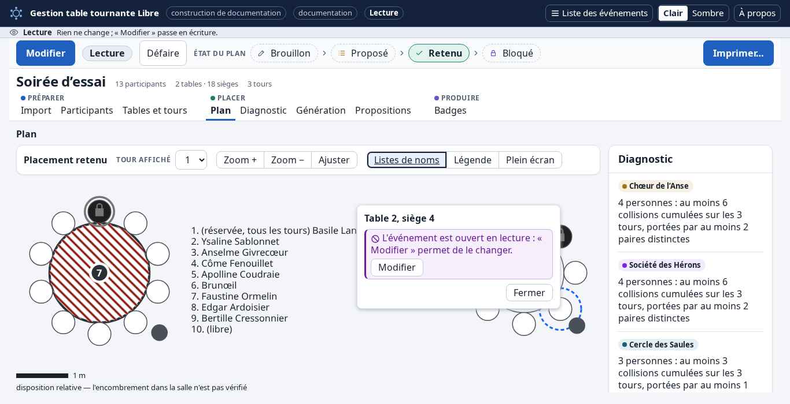

*La bande de mode et le libellé « Lecture » le disent au-dessus du plan, et le
bandeau le répète.
Glisser une personne ou une table, tirer une poignée, poser une réservation :
chaque geste est refusé avec « Modifier » pour remède, et rien ne change sur le
disque.*

**L’historique** s’ouvre par « Historique… », dans la barre de l’événement :
à côté du plan, la liste de vos gestes, le plus récent en haut, chacun avec sa
date et son heure ; « Revenir à cet instant » rend l’état de l’un d’eux sans
rien effacer. Une ligne grisée marquée « fil abandonné » est un geste que vous
avez défait puis remplacé par un autre : il reste dans la liste, et vous pouvez
encore y revenir. Pour nommer l’instant courant, tapez son nom dans le champ du
panneau, puis « Nommer » ; la case « Instants nommés seulement » ne garde que
ceux-là.

*En tête, l’instant courant, nommé « Avant l’accueil ». Dessous, le retour fait
au clavier : son libellé nomme la touche, « Défait (Ctrl+Z) ». Plus bas, le
geste défait, en gris, porte la pastille « fil abandonné ». Hors d’un champ de
saisie, Ctrl+Z défait le dernier geste, Ctrl+Maj+Z ou Ctrl+Y le refait
(annexe D).*

## Étape 12 — Imprimer

La commande « Imprimer… », en haut de l’événement, ouvre l’**aperçu
d’impression**, qui montre les pages telles qu’elles sortiront : le **plan**
de salle, la **liste d’accueil** et la **feuille par table**. Le plan se
découpe en pages quand il ne tient pas lisiblement sur une seule ; chaque page
porte son repère et ses voisines. Au premier aperçu, le logiciel demande le
format du papier, A4 ou Lettre, puis le garde pour ce poste ; il se change
ensuite à tout moment.

La **planche de badges** est le seul document produit en PDF. Par défaut, elle
s’imprime sur des **cartes Avery 5392** prédécoupées, six par feuille Lettre,
sans rien à découper ; le modèle **A6 à découper** reste offert, quatre badges
par feuille A4 ou deux par feuille Lettre, avec leurs traits de coupe. Une
**feuille de contrôle** l’accompagne : mesurez son échelle sous une règle avant
d’imprimer, pour vérifier que l’imprimante n’a pas réduit la page. Les badges
se tirent du placement retenu, ou d’une proposition choisie.

Imprimer et produire la planche ne modifient pas l’événement : ces commandes
restent disponibles en lecture et sur un plan bloqué. Le logiciel n’interdit
pas d’imprimer un plan qui n’est pas retenu, mais il le marque **BROUILLON**
en filigrane ; une planche tirée d’une proposition l’est toujours. Chaque page
imprimée porte en pied le nom et la date de l’événement, le tour, l’instant où
le placement a pris sa forme, et la version du logiciel.

L’aperçu imprime ce que le plan montre. Une proposition ouverte depuis la
section « Propositions » s’imprime en brouillon, même quand un autre placement
est retenu :

*Le filigrane BROUILLON couvre chaque page. Sous le plan, le repère de la
page, l’échelle graphique et la mention « disposition relative » ; en pied, le
tour et l’instant où cette proposition a été générée.*

Revenu au placement retenu, l’aperçu sort sans filigrane :

*Le même cadrage, sur le placement retenu : le filigrane a disparu, et le pied
porte l’instant de ce placement. C’est cette page qui part à l’imprimante pour
le montage de la salle.*

La planche se produit dans la section « Badges » de l’événement. On y choisit le
**modèle de badge** — Avery 5392, ou A6 à découper —, que le poste garde d’une
fois à l’autre, et l’ordre des badges, alphabétique ou par table du premier
tour. Avec l’A6 seulement, la section montre aussi le papier — Lettre tant que
le poste n’en a pas choisi d’autre, « Changer » le remplace — et l’imposition —
feuille par feuille, ou en pile pour un massicot qui tranche toute la rame. Une
case, cochée tant que vous ne la décochez pas, ajoute sous le pied de chaque
badge le **pied TechnoLibre** : une invitation à demander un développement
logiciel personnalisé, suivie du logo de TechnoLibre en couleurs ; le poste
garde ce choix, comme le modèle. Le pied TechnoLibre ne prend que la place
libre : il rapetisse sur un badge chargé, et s’en retire quand même sa plus
petite taille ne tient pas, ou que le badge a dû perdre le nom de l’événement.
Sous la case, un champ porte le **texte du pied TechnoLibre**, prérempli de
cette invitation : remplacez-le par le vôtre, et le poste le garde, comme la
case ; « Texte par défaut » remet l’invitation d’origine. Un dossier de
travail où vous n’avez rien saisi imprime l’invitation d’origine. Le texte
s’enregistre quand vous quittez le champ. Il se replie seul sur le badge : un
retour à la ligne saisi y devient une espace. Laissé vide, le pied ne porte
que le logo. Un texte plus long rapetisse et se retire plus tôt, faute de
place, et un caractère que la police ne dessine pas s’annonce comme dans un
nom.
À côté, cinq autres cases, cochées elles aussi tant que vous ne les décochez
pas, disent ce que chaque badge imprime en plus du nom et des tours :
« Organisation », « Nom de l’événement », « Date de l’événement », « Date du
placement » — la ligne « Placement du … à … » — et « Identifiant » — la ligne
« Identifiant n° … » qui sépare deux homonymes. Le poste les garde, comme le
modèle. Une case décochée retire sa donnée de chaque badge, et la place
libérée revient au reste ; le nom et la date de l’événement partagent une
ligne, qui disparaît quand les deux sont décochés. La feuille de contrôle
ajoute alors une ligne « Données retirées des badges : … » qui les nomme ; la
liste en CSV, elle, ne change pas.

Le badge d’une personne qui porte un logo (étape 3) le pose entre ses tours et
le pied, dans la place que le texte laisse : le logo ne rapetisse ni ne retire
jamais un texte. Il s’y pose le plus grand possible, proportions gardées ; le
pied TechnoLibre lui cède d’abord de la place en rapetissant, puis s’en retire
quand le logo ne tient qu’ainsi. Un logo dont la plus petite dimension
n’atteindrait pas 8 mm ne se pose pas, et le badge sort tel qu’il serait sans
logo ; un badge qui a perdu le nom de l’événement n’en porte pas non plus. Une
image introuvable ou illisible n’arrête rien : son badge s’imprime sans logo.
« Préparer » annonce ce qui sortira : le nombre de badges et de feuilles, les
homonymes, les caractères que la police ne dessine pas, les personnes dont le
logo est introuvable ou illisible, les badges sans place pour leur logo, les
badges d’où le pied TechnoLibre se retire, le nom des fichiers.
« Produire la planche (PDF) » écrit le PDF dans le dossier de l’événement et
en affiche le chemin ; « Ouvrir le dossier » montre ce dossier dans
l’explorateur ; dans un navigateur, le PDF se télécharge. « Produire la
liste (CSV) » écrit au même endroit la liste des mêmes badges, pour un tableur :
une ligne par personne, avec son nom, son prénom, son organisation et, dans une
seule cellule, ses lignes de tour telles que le badge les compose, jamais
abrégées, et jamais le logo ; tirée d’une proposition, son nom de fichier porte
« BROUILLON ». Avec l’A6, la feuille de contrôle est la première page de la
planche ; avec Avery 5392, elle est un **second PDF**, écrit à côté du premier,
à imprimer sur papier ordinaire pour ne pas gâcher une feuille de cartes :

*La règle du haut mesure 100 mm sur le papier : posez-y une vraie règle. Si les
deux ne coïncident pas, l’imprimante a mis la page à l’échelle. Le contour des
six cartes est à leur place exacte : posée sur une feuille Avery 5392, devant
une fenêtre, la feuille imprimée doit le montrer sur les prédécoupes. Suivent
le format du badge et du papier, le nombre de feuilles, les comptes de la
soirée — un badge par personne présente, les exclus comptés à part —, l’instant
du placement et la version du logiciel.*

Quand un badge au moins désigne un logo, la feuille de contrôle ajoute une ligne
qui les compte, par exemple « Logos : 12 posés, 2 sans place, 1 introuvable » ;
elle ne porte jamais d’image.

Vient ensuite la planche, six cartes par feuille :

*Chaque badge porte le nom, l’organisation et la table de chaque tour, son
libellé entre parenthèses quand elle en a un ; une personne assise à la même
table à chaque tour lit une seule ligne, comme « Toute la soirée — table 1
(Table d’honneur) » sur le quatrième badge. En pied, le nom de l’événement et
l’instant du placement, puis le pied TechnoLibre et son logo en couleurs, que la
case de la section retire. Les cartes étant prédécoupées, la feuille ne porte
aucun trait de coupe ; avec l’A6, des traits fins marquent la coupe.*

Une personne absente à un tour garde la ligne de ce tour sur son badge, qui
dit « absente » au lieu d’une table :

*Sur la petite démonstration, la meilleure dérivée de l’étape 9 retenue :
les badges de la personne partie après le tour 2 et de celle arrivée au
tour 3, réédités seuls dans la section « Badges ». Chaque tour garde sa
ligne ; une personne absente à un tour n’a jamais la ligne « Toute la
soirée ».*

Une fois le plan imprimé, bloquez-le : choisissez l’état « Bloqué » en haut de
l’événement. Plus rien ne le modifie, jusqu’à « Débloquer ».

**Ce qui doit avoir eu lieu.** Il faut des tables (étape 4) et au moins une
personne (étape 2 ou 3) avant de générer ; il faut avoir retenu un placement
(étape 10) pour qu’une impression ne sorte pas en brouillon. Tout le reste est
facultatif, et se reprend dans n’importe quel ordre.

## Le panneau « À propos »

La commande « À propos » du bandeau ouvre un panneau qui remplace l’écran ;
« Fermer » rend celui d’où vous l’avez ouvert. Il donne la ligne de version à
copier dans un signalement, l’éditeur et l’auteur, l’attribution demandée, la
licence du logiciel et ses deux textes complets, et le sommaire des
fonctionnalités.

Sa carte **« Composants tiers et leurs licences »** nomme chaque œuvre que le
logiciel incorpore — Svelte, pdf-lib, le solveur HiGHS, la police Noto Sans,
entre autres —, avec sa version et sa licence ; les œuvres qu’un paquet
incorpore à son tour suivent en retrait, sous lui. « Lire la licence » montre
le texte de l’une sous son nom, sans réseau ; un seul texte s’affiche à la
fois dans le panneau, et « Fermer le texte » le retire. La liste vient du
fichier `licences/TIERS.txt`, livré avec le logiciel, qui porte les mêmes avis.

## Comment le logiciel cherche

Cette section répond à deux questions : pourquoi deux propositions issues du
même plan diffèrent, et pourquoi relancer aide parfois, et parfois jamais.

### Le problème

Asseoir chaque personne présente, à chacun de ses tours, de sorte que la
personne la plus mal servie rencontre le plus de monde possible. L’ordre par
défaut le poursuit après les rencontres répétées et les collisions ; vous pouvez
le ranger devant elles, dans l’ordre des priorités de la section « Génération ».
Le profil trié de la page « Qualité » range les personnes de la moins servie à
la mieux servie ([le profil trié](doc/captures/12-qualite-profil.png)) : la plus
mal servie est au premier rang.

### Pourquoi il n’a pas de réponse évidente

Prenez les douze personnes de la petite démonstration et ses quatre tables
numérotées de trois places. Pour un seul tour, il y a 369 600 façons de les
répartir : on compte toutes les façons d’aligner les douze personnes, puis on
cesse de distinguer l’ordre des trois personnes d’une même table. Sur quatre
tours, le nombre dépasse 10²². Le logiciel n’essaie donc pas toutes les
combinaisons — et la petite démonstration est déjà le plus petit cas qu’il
livre.

### Comment la recherche avance

Le logiciel part d’un placement complet, dont le point de départ dépend de la
**graine**. Il **échange** des personnes entre les tables, garde ce qui ne
dégrade pas le placement, et s’arrête après un **compte** de mouvements
essayés — le compte d’arrêt de la section « Génération » —, ou plus tôt s’il
ne reste rien à améliorer.

D’où la réponse à la première question : deux recherches parties de deux
points différents s’arrêtent sur deux placements différents, et aucun des deux
n’est « le bon ». La même graine, sur la même configuration et les mêmes
réglages, redonne exactement les mêmes propositions ; une autre graine en donne
d’autres. Cette phrase est vérifiée par une épreuve du logiciel.

La page « Qualité » montre la course d’une recherche
([la performance du calcul](doc/captures/15c-qualite-performance.png)) :
chaque valeur de la proposition, mesurée sur le meilleur placement trouvé
après un, dix, cent, mille mouvements, et ainsi de suite, puis au dernier.
Quand plus rien ne change pendant les derniers relevés, la recherche est sur
un plateau, et relancer plus longtemps la même graine a peu de chances
d’aider ; quand une valeur change encore au dernier point, comme sur cet
écran, un compte d’arrêt plus grand peut faire mieux. La page ne dit rien
des mouvements que la recherche n’a pas essayés.

### Ce que font les contraintes

« Séparer les organisations », « Nouveaux voisins à chaque tour », « Nouvelle
table à chaque tour », « Varier les organisations rencontrées » sont des
**objectifs**, pas des interdits. Quand ils ne tiennent pas tous ensemble, le
logiciel produit le meilleur compromis et dit lequel, au lieu de refuser et de
ne rien montrer.

### Le plafond

Dans la petite démonstration, chacun a deux voisins par tour : en quatre tours,
il rencontre au plus 8 personnes, sur onze personnes qu’il pourrait rencontrer.
Personne ne peut faire mieux, et ce n’est pas un défaut du logiciel. À une
table de huit, chacun a sept voisins : en quatre tours, 28 rencontres au plus.
Dans la grande démonstration, les quatre animateurs des tables de sept restent
à leur table toute la soirée, et leur plafond vaut 24. Le diagnostic affiche
ces plafonds avant toute recherche
([le diagnostic de la grande démonstration](doc/captures/10-diagnostic.png)) :
**la relance ne déplace jamais un plafond.**

### Ce que « minimum atteint » veut dire

La colonne « Certificat » du tableau des propositions écrit « minimum atteint »
quand chaque personne rencontre autant de monde que son plafond a priori le
permet : personne ne peut faire mieux, et relancer ne sert plus à rien. Le
minimum se mesure contre le plafond a priori, pas contre ce qu’un placement
donné rendait possible. C’est pourquoi la grande démonstration ne l’obtient
jamais : son diagnostic prouve, avant toute recherche, que des personnes
finiront sous leur plafond a priori — c’est le plancher de l’écart
d’itinéraire.

La page « Qualité » l’écrit sous son en-tête chiffré
([« minimum atteint » sur la petite démonstration](doc/captures/16-minimum-atteint.png)),
avec les compteurs mesurés de la proposition.

Son absence ne dit pas qu’un meilleur placement existe. « Atteignabilité
inconnue » dit que le logiciel ne sait pas si mieux est possible.

### Ce que relancer ne peut pas

Relancer n’efface pas les collisions que le diagnostic annonce comme
inévitables — les « au moins » de chaque organisation trop nombreuse pour ses
tables —, et ne crée pas une table qui n’existe pas. Le diagnostic dit **avant**
la recherche ce qui est hors d’atteinte, et quel changement de configuration le
lèverait : une table de plus, un tour de moins, une organisation mieux
répartie.

### Comparer deux propositions

Comparez par le **manque** : pour chaque personne, l’écart entre ce que son
placement lui permettait de rencontrer et ce qu’elle rencontre. Les nombres
bruts ne se comparent plus dès qu’une table est incomplète : qui s’assied à
cette table rencontre moins de monde, et cela change d’une proposition à
l’autre.

Trois colonnes le disent ([le tableau classé](doc/captures/11-propositions.png)).
« Plus grand manque » : de combien la personne la plus privée l’est-elle, compte
tenu de là où ce placement l’a assise. « Personnes à qui il en manque » : une
seule personne, ou quarante ? Les deux appellent des décisions opposées —
déplacer quelqu’un, ou ajouter une table. « Écart d’itinéraire maximal » : la
proposition a-t-elle perdu avant même que chacun s’asseye, en envoyant
quelqu’un à des tables incomplètes ou trop souvent aux mêmes tables ?

C’est la troisième colonne qui évite le contresens : une personne laissée en
réserve pendant presque toute la soirée a un manque nul, puisqu’elle n’avait
presque personne à rencontrer. Un manque nul sur un itinéraire bas n’est pas
une bonne nouvelle.

La page « Qualité » pose la même question pour deux placements à la fois :
le manque de chacun, rang par rang, sur un même axe
([la comparaison de deux placements](doc/captures/17-comparaison-manque.png)),
et le même escalier en tableau
([l’escalier du manque](doc/captures/18-comparaison-escalier.png)) ; les
colonnes du tableau des propositions en donnent les chiffres. Deux courbes
qui se croisent disent que chacune sert mieux une part de la salle : aucune
n’est meilleure partout, et c’est l’ordre des priorités qui tranche. Une
proposition dérivée d’une autre entre au même classement que son départ
([les propositions dérivées](doc/captures/11b-propositions-derivees.png)) :
c’est ce classement qui dit laquelle des deux sert mieux.

### L’écart entre les propositions d’une génération

Quand la meilleure et la moins bonne proposition d’une même génération
atteignent le même minimum, c’est le plus souvent qu’une borne le tient, et
relancer n’y changera rien. C’est **un indice, pas une preuve**. Le plafond a
priori, que le diagnostic affiche, le dit d’un coup d’œil : quand le minimum
d’une proposition l’égale, c’est la borne qui le tient, et aucune relance ne
fera mieux. Sur la page « Qualité », la tuile du minimum porte ce plafond à
côté du minimum, pour la personne au premier rang du profil.

## Annexe A — Les réglages et leurs valeurs par défaut

Les réglages que l’événement enregistre, l’écran qui les montre et leur valeur
à la création d’un événement. Les cœurs de calcul n’y figurent pas : c’est un
réglage du poste, pour la séance, automatique par défaut (étape 9).

<!-- engendre:debut reglages -->

| Réglage | Écran | Valeur par défaut |
|---|---|---|
| Propositions par génération (nombre de propositions) | Génération | 20 |
| Compte d'arrêt (mouvements évalués par proposition) | Génération | 2 000 000 |
| Historique d'acceptation (longueur, en mouvements) | Génération | 1 000 |
| Séparer les organisations | Génération | cochée |
| Nouveaux voisins à chaque tour | Génération | cochée |
| Nouvelle table à chaque tour | Génération | cochée |
| Varier les organisations rencontrées | Génération | cochée |
| Respecter les objectifs des tables | Génération | cochée |
| Rencontrer le plus d'animateurs différents | Génération | décochée |
| Attribuer les sièges | Génération | décochée |
| Objectifs des tables : chercher d'abord | Génération | le plus de places servies |
| Ordre des priorités | Génération | conflits d'organisation, puis excédent de collisions, puis rencontres répétées et retours, puis collisions cumulées, puis écart au plafond a priori, puis tours hors objectif, puis animateurs non rencontrés, puis redondance d'organisation |

<!-- engendre:fin reglages -->

## Annexe B — Les colonnes reconnues à l’import

Chaque colonne que l’import reconnaît, sous son en-tête d’export, et les autres
intitulés qu’il accepte pour elle. Les intitulés se comparent sans égard aux
majuscules ni aux accents.

<!-- engendre:debut colonnes-csv -->

| Colonne | Synonymes reconnus |
|---|---|
| `nom` | — |
| `prenom` | — |
| `organisation` | `appartenance`, `entreprise`, `équipe` |
| `courriel` | — |
| `titre_pressenti` | `titre`, `rôle` |
| `exclu` | — |
| `notes` | — |
| `etiquettes` | `étiquette`, `mots-clés` |
| `presence` | `présence`, `tours de présence` |
| `conflit_organisation` | `conflits`, `conflit d'organisation`, `conflit d’organisation` |

<!-- engendre:fin colonnes-csv -->

Les objectifs des tables s’importent par leur propre fichier, qui reconnaît
ces colonnes de la même façon ; la table se désigne par le numéro qu’elle
affiche sur le plan.

<!-- engendre:debut colonnes-objectifs -->

| Colonne | Synonymes reconnus |
|---|---|
| `table` | — |
| `tour` | — |
| `objectif` | `objectifs` |
| `regle` | `règle` |

<!-- engendre:fin colonnes-objectifs -->

## Annexe C — Les commandes et leur trace dans l’historique

Chaque geste qui modifie l’événement, et la ligne qu’il laisse dans
l’historique ; les noms des exemples sont inventés.

<!-- engendre:debut commandes -->

| Commande | Libellé d'historique (exemple) |
|---|---|
| `ajouterParticipant` | Ajouté Iris Ombrelle |
| `modifierParticipant` | Modifié Ondine Lacasse : courriel |
| `changerEtiquettes` | Étiquettes de Iris Ombrelle : ajouté « finance » |
| `ajouterConflit` | Conflits de Iris Ombrelle : ajouté « Atelier Ressac » |
| `retirerConflit` | Conflits de Iris Ombrelle : retiré « Atelier Ressac » |
| `changerConflits` | Conflits de Iris Ombrelle : ajouté « Atelier Ressac » et « Club des Merles » |
| `changerLogo` | Logo de Iris Ombrelle : posé |
| `exclureParticipant` | Exclu Théo Pervenche |
| `reintegrerParticipant` | Réintégré Théo Pervenche |
| `supprimerParticipant` | Supprimé Ondine Lacasse |
| `importerParticipants` | Importé 12 participants |
| `importerObjectifs` | Mis à jour les objectifs de table par import : 3 ajoutés, 1 remplacé |
| `changerEtat` | Plan passé à l'état « Bloqué » |
| `debloquer` | Plan débloqué, état « Retenu » |
| `enregistrerGeneration` | Généré 5 propositions (n° 3 à 7) |
| `retenirProposition` | Retenu la proposition n° 3 |
| `effacerPropositions` | Effacé 4 propositions, gardé la retenue (n° 2) |
| `garderMeilleures` | Gardé les 10 meilleures propositions, effacé 37 propositions, gardé aussi la retenue (n° 42) |
| `creerTable` | Ajouté la table 3 |
| `supprimerTable` | Supprimé la table 2 ; retirés : 2 réservations et 1 titre |
| `deplacerTable` | Déplacé la table 3 |
| `changerLibelleTable` | Table 3 : libellé « Coin des invités » |
| `changerPlacesTable` | Table 5 : 10 places |
| `realignerTable` | Table 5 : suit le défaut (8 places) |
| `changerDefaut` | Sièges par défaut : 10 ; 4 tables réalignées |
| `changerTours` | Nombre de tours : 3 ; 2 réservations retirées |
| `modifierReglage` | Séparer les organisations : désactivé |
| `poserObjectif` | Table 3 : objectif de la soirée « finance », règle par défaut |
| `retirerObjectif` | Table 3, tour 2 : objectif retiré |
| `changerRegleObjectifs` | Règle par défaut des objectifs : toutes les étiquettes |
| `changerPriorites` | Ordre des priorités : « collisions cumulées » au palier 2 sur 6, avec « excédent de collisions » |
| `retablirPriorites` | Ordre des priorités : ordre par défaut rétabli |
| `reserver` | Réservé Théo Pervenche à la table 4, siège 2, tour 2 |
| `retirerReservation` | Réservation retirée : Théo Pervenche, table 4, tous les tours |
| `deplacerReservation` | Réservation déplacée : Théo Pervenche, de la table 4 à la table 7, tour 2 |
| `poserTitre` | Posé le titre « accueil » à la table 3, siège 1 |
| `retirerTitre` | Retiré le titre « accueil » de la table 3, siège 1 |
| `designer` | Désigné Iris Ombrelle à la table 3, siège 1 : « accueil » |
| `designerAnimateurs` | Désigné 3 animateurs à la table 5 : Iris Ombrelle, Théo Pervenche, Ondine Lacasse |
| `retirerAnimateur` | Retiré l'animateur Iris Ombrelle de la table 5 |
| `convertirEnTous` | Converti en « tous les tours » : Iris Ombrelle, table 3 |
| `deplacerDansRetenu` | Déplacé Iris Ombrelle de la table 4 à la table 7, tour 2 |
| `echangerDansRetenu` | Échangé Iris Ombrelle (table 4) et Théo Pervenche (réserve), tour 2 |
| `retirerDuTour` | Retiré Iris Ombrelle de la table 4, tour 2 |
| `changerPresence` | Présence de Iris Ombrelle : tours 1 et 2, au lieu de tous les tours ; retirée du placement retenu aux tours 3 et 4 |

<!-- engendre:fin commandes -->

## Annexe D — Les raccourcis clavier

<!-- engendre:debut raccourcis -->

| Où | Touches | Effet |
|---|---|---|
| Plan | → | Passe à la table voisine à droite, ou au siège suivant. |
| Plan | ↓ | Passe à la table voisine en dessous, ou au siège suivant. |
| Plan | ← | Passe à la table voisine à gauche, ou au siège précédent. |
| Plan | ↑ | Passe à la table voisine au-dessus, ou au siège précédent. |
| Plan | Entrée ou Espace | Descend dans les sièges de la table, ou choisit la place. |
| Plan | Échap | Remonte du siège à sa table ; sur une table, oublie le choix. |
| Grille des participants | → | Passe à la cellule de droite. |
| Grille des participants | ↓ | Passe à la cellule du dessous. |
| Grille des participants | ← | Passe à la cellule de gauche. |
| Grille des participants | ↑ | Passe à la cellule du dessus. |
| Grille des participants | Tab | Valide la saisie en cours et passe à la cellule suivante. |
| Grille des participants | Maj+Tab | Valide la saisie en cours et revient à la cellule précédente. |
| Grille des participants | Entrée ou F2 | Ouvre la saisie de la cellule — les cases de présence comprises —, ou bascule l'exclusion. |
| Grille des participants | Échap | Efface le refus affiché sous la cellule. |
| Cases de présence, grille ou fiche | ← | Passe à la case du tour précédent. |
| Cases de présence, grille ou fiche | → | Passe à la case du tour suivant. |
| Cases de présence, grille ou fiche | Début | Passe à la case du premier tour. |
| Cases de présence, grille ou fiche | Fin | Passe à la case du dernier tour. |
| Champ de saisie | Entrée | Valide la saisie. |
| Champ de saisie | Échap | Rend la valeur d'avant la saisie. |
| Bouton de commande | Entrée ou Espace | Exécute la commande une fois, même maintenue. |
| Bouton de menu | Entrée ou Espace ou ↓ | Ouvre le menu sur sa première action. |
| Bouton de menu | ↑ | Ouvre le menu sur sa dernière action. |
| Menu ouvert | ↓ | Passe à l'action suivante ; après la dernière, revient à la première. |
| Menu ouvert | ↑ | Passe à l'action précédente ; avant la première, va à la dernière. |
| Menu ouvert | Début | Va à la première action. |
| Menu ouvert | Fin | Va à la dernière action. |
| Menu ouvert | Échap | Ferme le menu et rend le focus à son bouton. |
| Menu ouvert | Tab | Ferme le menu ; le focus passe au contrôle suivant. |
| Geste en cours | Échap | Annule le geste en cours : la table revient où elle était. |
| Écran de l’événement, hors saisie | Ctrl+Z | Défait le dernier geste. |
| Écran de l’événement, hors saisie | Ctrl+Maj+Z ou Ctrl+Y | Refait le dernier retour. |
| Panneau ou infobulle | Échap | Ferme le panneau ou l'infobulle. |

<!-- engendre:fin raccourcis -->

## Annexe E — Les démonstrations livrées

Les démonstrations que le premier écran offre, lues dans leurs fichiers : leur
taille et l’étendue de leur plafond a priori.

<!-- engendre:debut demonstrations -->

| Démonstration | Effectif | Tables | Tours | Plafond a priori, minimum | Plafond a priori, maximum |
|---|---|---|---|---|---|
| Grande démonstration | 260 | 33 | 4 | 24 | 28 |
| Grande démonstration sans exception | 260 | 33 | 4 | 28 | 28 |
| Petite démonstration | 12 | 4 | 4 | 8 | 8 |
| Petite démonstration, conflit inévitable | 12 | 4 | 4 | 8 | 8 |

<!-- engendre:fin demonstrations -->
