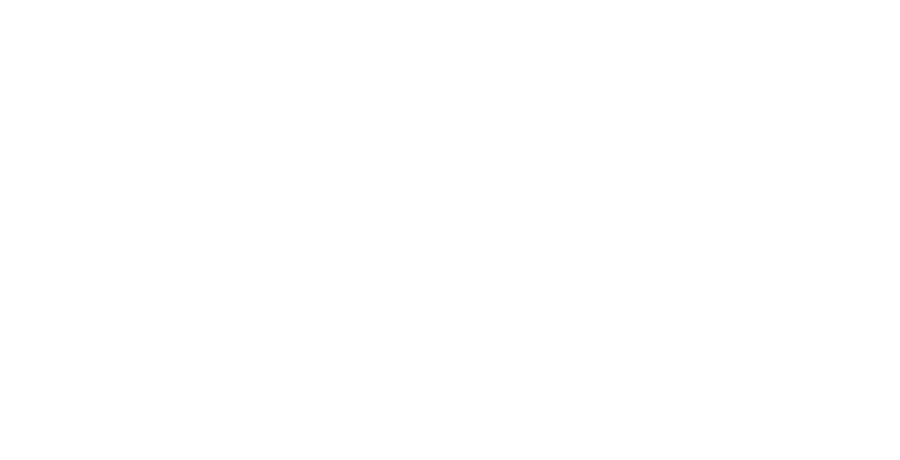

# Arbre d'épreuve des régions engendrées

Un petit arbre inventé que lisent les épreuves de `scripts/documentation.js`.
Son seul fichier porteur est ce document ; sa région se nourrit du manifeste
de `doc/captures/`, qui ne porte aucune version réelle : l'épreuve l'y écrit
dans une copie temporaire.

## Contrastes

<!-- engendre:debut contrastes -->

| Jeton | Rôle | Seuil | Thème clair | Capture | Thème sombre | Capture |
|---|---|---|---|---|---|---|
| `encre` | marque | 3 | — | — | 5,50 | 02-import-apercu |
| `encre` | texte | 4,5 | 9,81 | 02-import-apercu | 11,20 | 01-premier-ecran |
| `encre-douce` | texte | 4,5 | 5,20 | 01-premier-ecran | 4,62 | 02-import-apercu |
| `focus` | marque | 3 | 3,40 | 01-premier-ecran | 3,90 | 02-import-apercu |

<!-- engendre:fin contrastes -->

Le texte qui suit la région ne bouge pas quand elle s'engendre.

## Captures

Chaque capture du manifeste est citée ici : la vérification refuse une
capture inscrite que nul porteur ne montre. Les deux images sont des aplats
inventés, aux dimensions du cadre.

